# Basecoat Blocks

**Beautifully designed, copy-and-paste blocks built with [Basecoat](https://basecoatui.com/).**  
Framework agnostic. Open source. Own the code.

> Built on **[Basecoat](https://github.com/hunvreus/basecoat)** by [@hunvreus](https://github.com/hunvreus): shadcn/ui-style components for any web stack, no React required. Docs and components: [basecoatui.com](https://basecoatui.com/).  
> **Independent community project. Not affiliated with or endorsed by Basecoat.**

<!-- overview:start -->
**51 blocks** · Basecoat 1.2.1 · plain HTML · light + dark

**Jump to:** [Authentication (6)](#authentication) · [Sidebar (3)](#sidebar) · [Dashboard (1)](#dashboard) · [Application (33)](#application) · [Marketing (8)](#marketing) · [Find by component](#find-by-component)
<!-- overview:end -->

Original HTML-first patterns for sign-in, sidebars, dashboards, app screens and marketing pages. There is no website, package or CLI: **this README is the catalog**. Pick a screenshot, open its code, paste it into your page. Every block is set in the same fictional company, **Acme Inc.**, so the placeholder name is obvious to replace. Screenshots follow your GitHub theme.

## Quick start

The blocks are plain HTML with Basecoat component classes and Tailwind utilities for layout, the same way the [Basecoat docs](https://basecoatui.com/) write their examples. You need a project with **Tailwind CSS 4** and **Basecoat 1.2.1**.

1. **Set up Basecoat once** (skip if your project already has it):

   ```sh
   npm install basecoat-css@1.2.1
   ```

   ```css
   /* your main CSS file */
   @import "tailwindcss";
   @import "basecoat-css";
   ```

   Blocks marked **needs Basecoat JS** also need Basecoat's JavaScript, loaded once (`import "basecoat-css/all";` in your bundle, or a script tag):

   ```html
   <script src="https://cdn.jsdelivr.net/npm/basecoat-css@1.2.1/dist/js/all.min.js" defer></script>
   ```

2. **Copy a block:** click a screenshot (or **Code**) to open its `block.html`, then use GitHub's *Copy raw file* button.
3. **Paste it into your template** and replace the Acme copy, links, data and form actions with your own. Tailwind picks up the utility classes when it scans your templates.

No React, Vue or component framework. No `<style>` blocks or custom class names to carry around.

## Browse the blocks

Under each screenshot: the Basecoat components it uses, whether it needs Basecoat JavaScript, and links to the code and its usage notes.

<!-- catalog:start -->
### Authentication

6 blocks · [category notes](blocks/authentication/README.md) · [back to top](#basecoat-blocks)

| Simple Login · `login-01` |
| --- |
| <a href="blocks/authentication/login-01/block.html"><picture><source media="(prefers-color-scheme: dark)" srcset="blocks/authentication/login-01/preview-dark.png">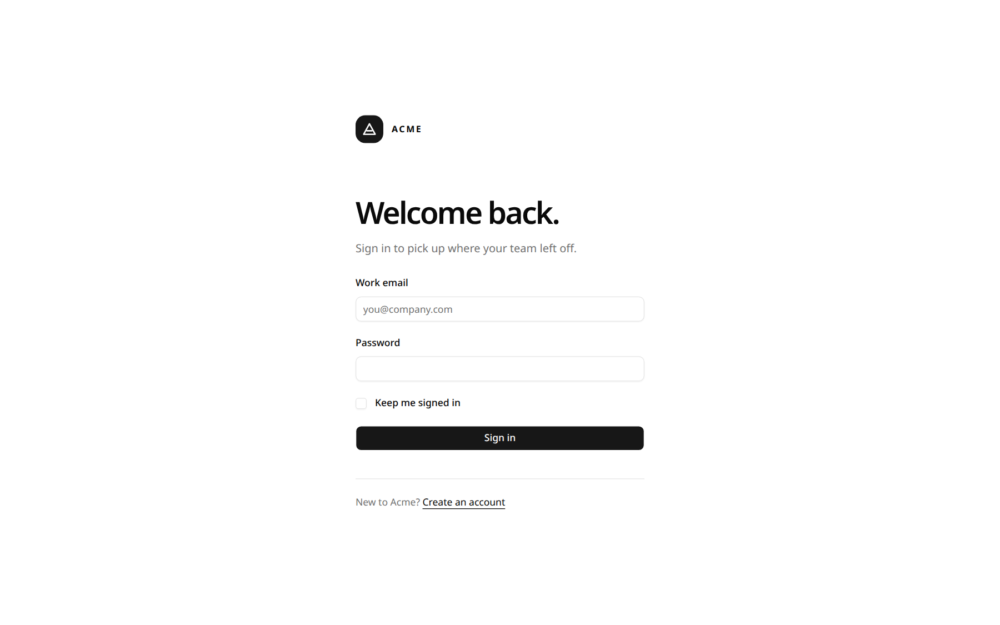</picture></a> |
| <sub>Button · Field · Input · Checkbox</sub><br>[Code](blocks/authentication/login-01/block.html) · [Notes](blocks/authentication/login-01/README.md) |

| Split Screen Login · `login-02` |
| --- |
| <a href="blocks/authentication/login-02/block.html"><picture><source media="(prefers-color-scheme: dark)" srcset="blocks/authentication/login-02/preview-dark.png">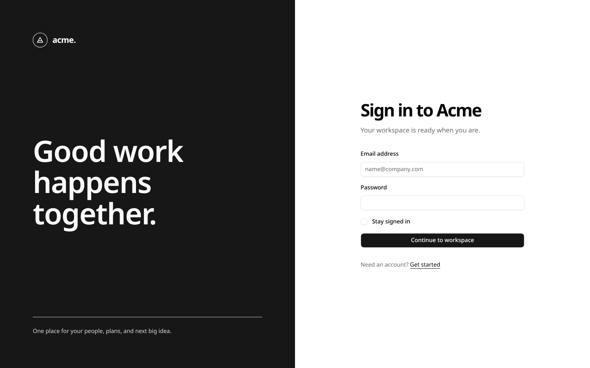</picture></a> |
| <sub>Button · Field · Input · Checkbox</sub><br>[Code](blocks/authentication/login-02/block.html) · [Notes](blocks/authentication/login-02/README.md) |

| Card Login · `login-03` |
| --- |
| <a href="blocks/authentication/login-03/block.html"><picture><source media="(prefers-color-scheme: dark)" srcset="blocks/authentication/login-03/preview-dark.png">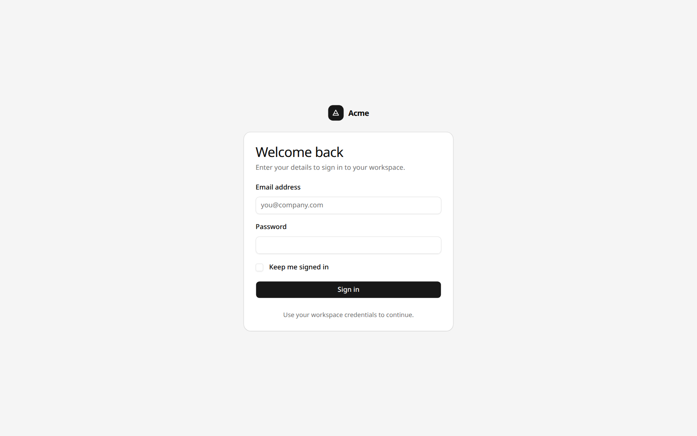</picture></a> |
| <sub>Card · Field · Input · Checkbox · Button</sub><br>[Code](blocks/authentication/login-03/block.html) · [Notes](blocks/authentication/login-03/README.md) |

| Signup · `signup-01` |
| --- |
| <a href="blocks/authentication/signup-01/block.html"><picture><source media="(prefers-color-scheme: dark)" srcset="blocks/authentication/signup-01/preview-dark.png">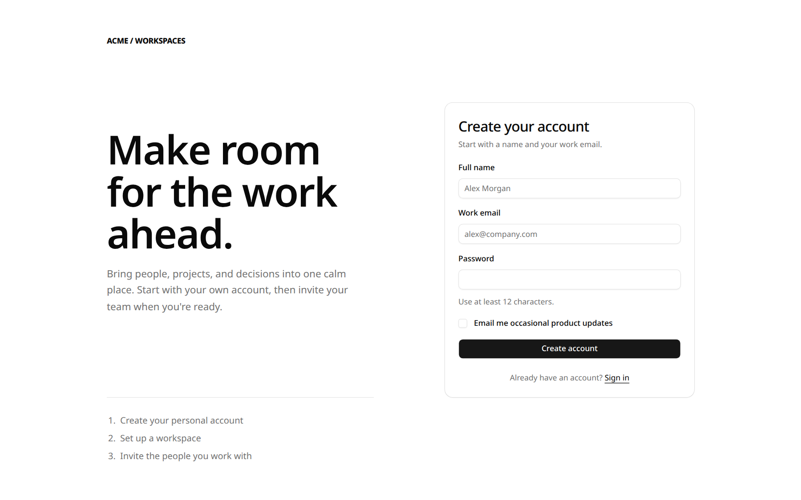</picture></a> |
| <sub>Card · Field · Input · Checkbox · Button</sub><br>[Code](blocks/authentication/signup-01/block.html) · [Notes](blocks/authentication/signup-01/README.md) |

| Email Verification · `otp-01` |
| --- |
| <a href="blocks/authentication/otp-01/block.html"><picture><source media="(prefers-color-scheme: dark)" srcset="blocks/authentication/otp-01/preview-dark.png">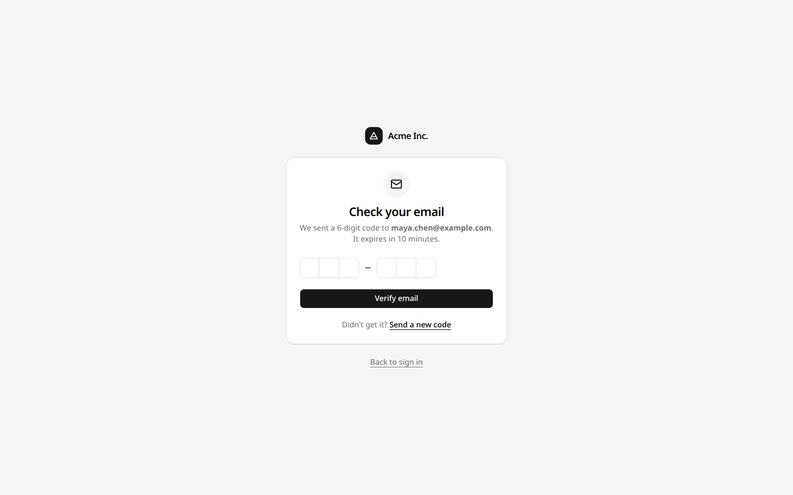</picture></a> |
| <sub>Card · Field · Input OTP · Button · <b>needs Basecoat JS</b></sub><br>[Code](blocks/authentication/otp-01/block.html) · [Notes](blocks/authentication/otp-01/README.md) |

| Forgot Password · `forgot-password-01` |
| --- |
| <a href="blocks/authentication/forgot-password-01/block.html"><picture><source media="(prefers-color-scheme: dark)" srcset="blocks/authentication/forgot-password-01/preview-dark.png">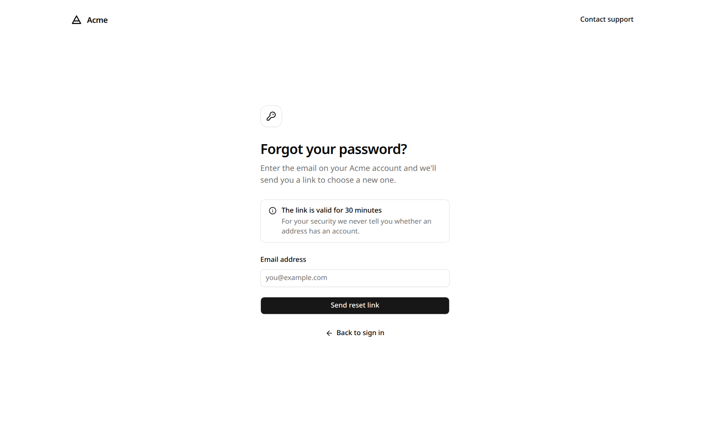</picture></a> |
| <sub>Alert · Field · Input · Button</sub><br>[Code](blocks/authentication/forgot-password-01/block.html) · [Notes](blocks/authentication/forgot-password-01/README.md) |

### Sidebar

3 blocks · [category notes](blocks/sidebar/README.md) · [back to top](#basecoat-blocks)

| Basic Sidebar · `sidebar-01` |
| --- |
| <a href="blocks/sidebar/sidebar-01/block.html"><picture><source media="(prefers-color-scheme: dark)" srcset="blocks/sidebar/sidebar-01/preview-dark.png">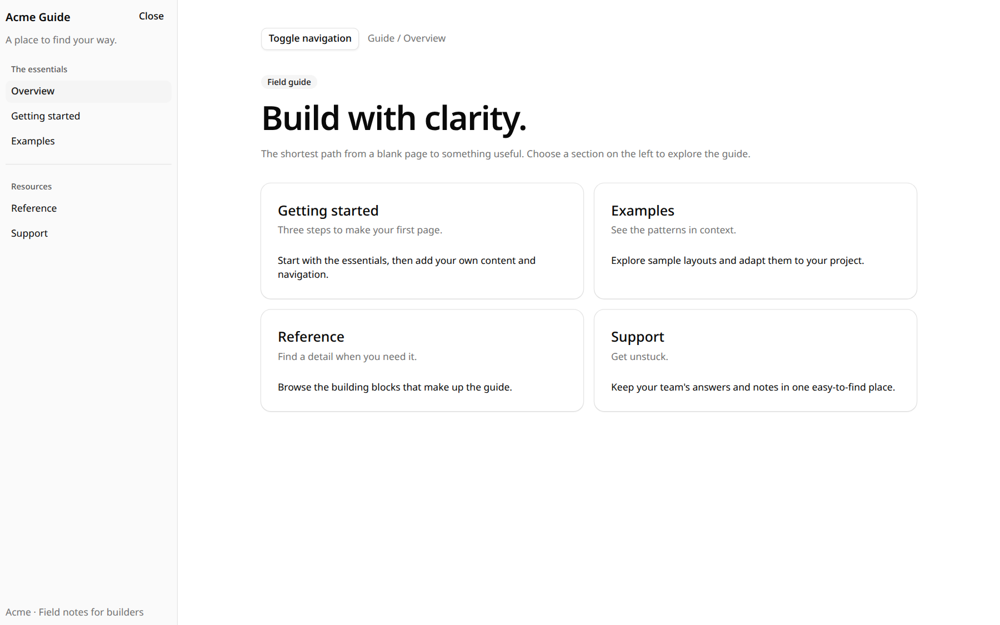</picture></a> |
| <sub>Sidebar · Button · Badge · Card · <b>needs Basecoat JS</b></sub><br>[Code](blocks/sidebar/sidebar-01/block.html) · [Notes](blocks/sidebar/sidebar-01/README.md) |

| Workspace Sidebar · `sidebar-02` |
| --- |
| <a href="blocks/sidebar/sidebar-02/block.html"><picture><source media="(prefers-color-scheme: dark)" srcset="blocks/sidebar/sidebar-02/preview-dark.png">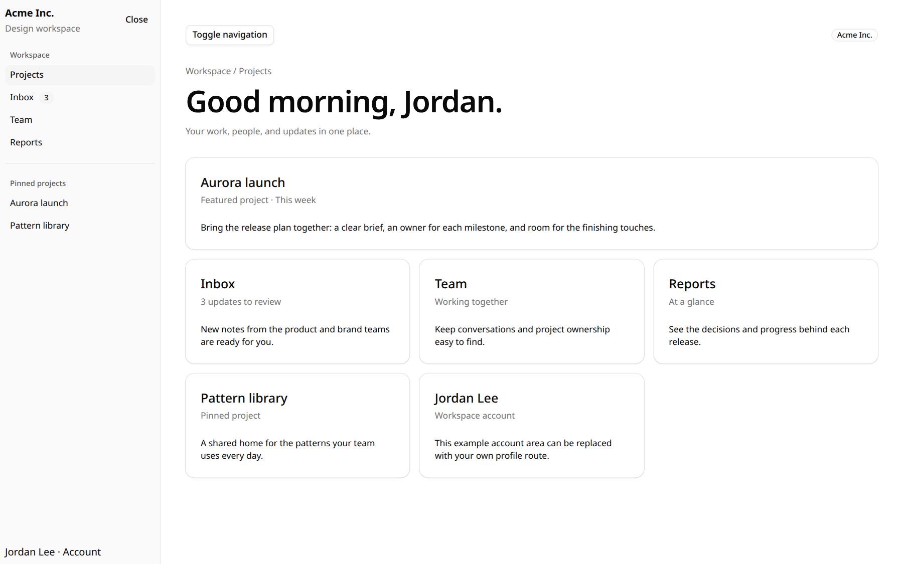</picture></a> |
| <sub>Sidebar · Button · Badge · Card · <b>needs Basecoat JS</b></sub><br>[Code](blocks/sidebar/sidebar-02/block.html) · [Notes](blocks/sidebar/sidebar-02/README.md) |

| Nested Sidebar · `sidebar-03` |
| --- |
| <a href="blocks/sidebar/sidebar-03/block.html"><picture><source media="(prefers-color-scheme: dark)" srcset="blocks/sidebar/sidebar-03/preview-dark.png">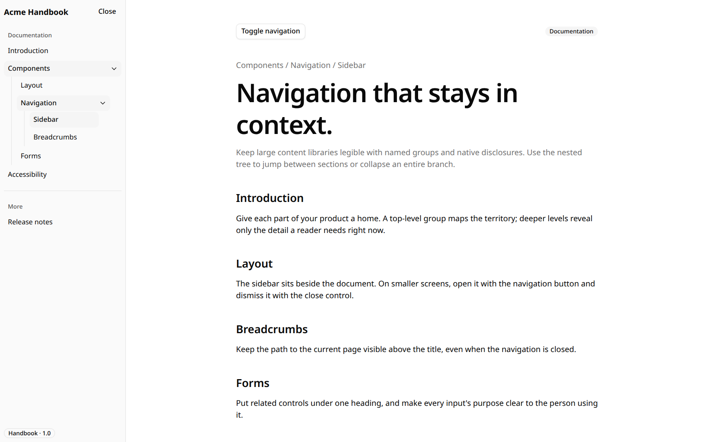</picture></a> |
| <sub>Sidebar · Button · Badge · <b>needs Basecoat JS</b></sub><br>[Code](blocks/sidebar/sidebar-03/block.html) · [Notes](blocks/sidebar/sidebar-03/README.md) |

### Dashboard

1 block · [category notes](blocks/dashboard/README.md) · [back to top](#basecoat-blocks)

| SaaS Dashboard · `dashboard-01` |
| --- |
| <a href="blocks/dashboard/dashboard-01/block.html"><picture><source media="(prefers-color-scheme: dark)" srcset="blocks/dashboard/dashboard-01/preview-dark.png">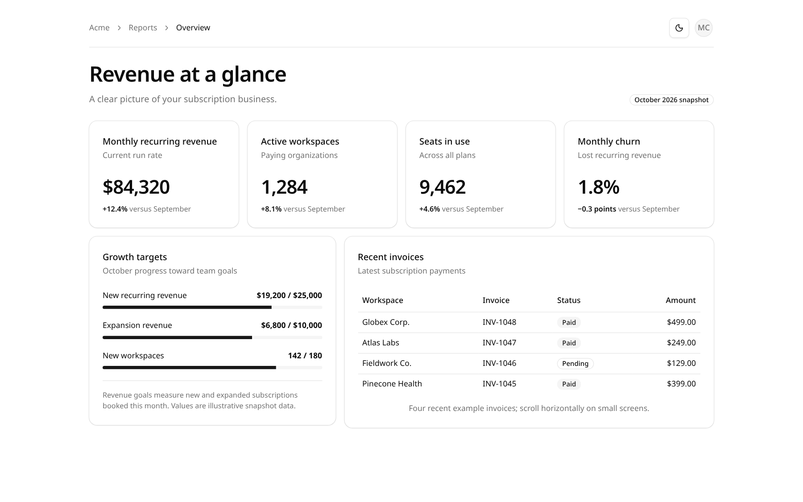</picture></a> |
| <sub>Breadcrumb · Theme Switcher · Tooltip · Dropdown Menu · Avatar · Card · Badge · Progress · Table · <b>needs Basecoat JS</b></sub><br>[Code](blocks/dashboard/dashboard-01/block.html) · [Notes](blocks/dashboard/dashboard-01/README.md) |

### Application

33 blocks · [category notes](blocks/application/README.md) · [back to top](#basecoat-blocks)

| Account Settings · `settings-01` |
| --- |
| <a href="blocks/application/settings-01/block.html"><picture><source media="(prefers-color-scheme: dark)" srcset="blocks/application/settings-01/preview-dark.png">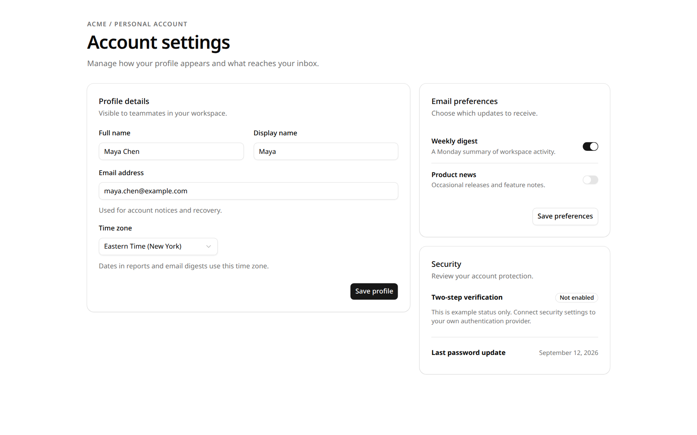</picture></a> |
| <sub>Card · Field · Input · Native Select · Switch · Button · Badge</sub><br>[Code](blocks/application/settings-01/block.html) · [Notes](blocks/application/settings-01/README.md) |

| Users Table · `users-01` |
| --- |
| <a href="blocks/application/users-01/block.html"><picture><source media="(prefers-color-scheme: dark)" srcset="blocks/application/users-01/preview-dark.png">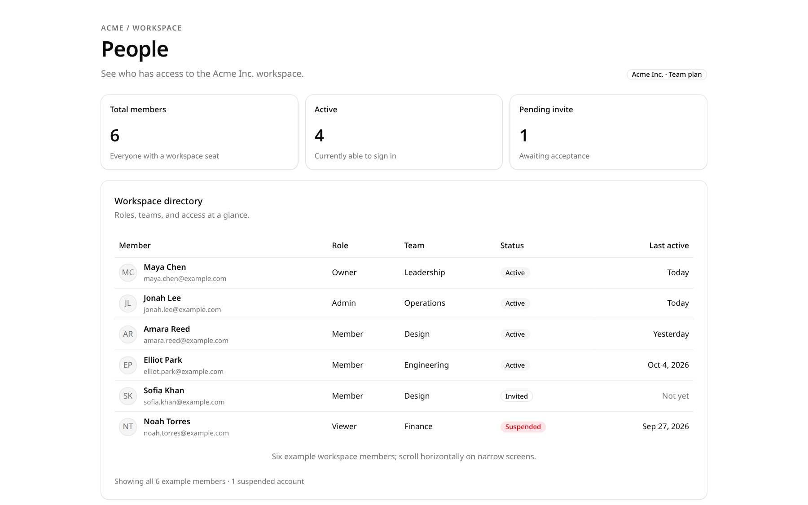</picture></a> |
| <sub>Card · Table · Avatar · Badge</sub><br>[Code](blocks/application/users-01/block.html) · [Notes](blocks/application/users-01/README.md) |

| API Keys · `api-keys-01` |
| --- |
| <a href="blocks/application/api-keys-01/block.html"><picture><source media="(prefers-color-scheme: dark)" srcset="blocks/application/api-keys-01/preview-dark.png">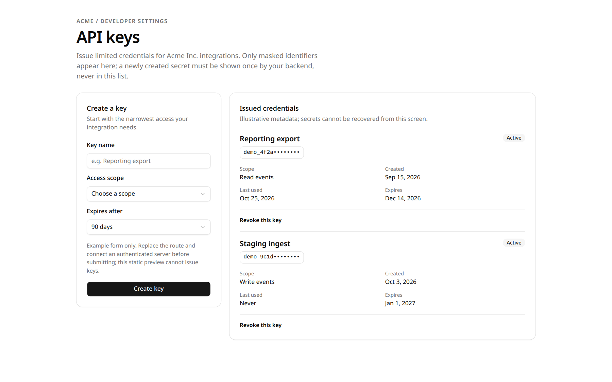</picture></a> |
| <sub>Card · Field · Input · Native Select · Button · Badge</sub><br>[Code](blocks/application/api-keys-01/block.html) · [Notes](blocks/application/api-keys-01/README.md) |

| Team Members · `team-members-01` |
| --- |
| <a href="blocks/application/team-members-01/block.html"><picture><source media="(prefers-color-scheme: dark)" srcset="blocks/application/team-members-01/preview-dark.png">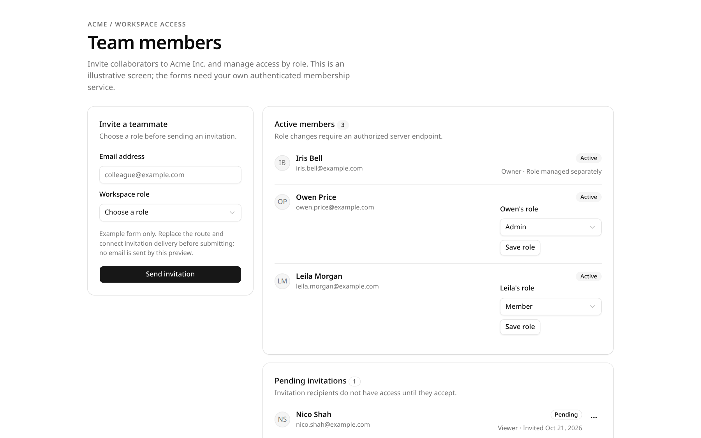</picture></a> |
| <sub>Card · Field · Input · Native Select · Button · Badge · Avatar · Dropdown Menu · Alert Dialog · <b>needs Basecoat JS</b></sub><br>[Code](blocks/application/team-members-01/block.html) · [Notes](blocks/application/team-members-01/README.md) |

| Billing Overview · `billing-01` |
| --- |
| <a href="blocks/application/billing-01/block.html"><picture><source media="(prefers-color-scheme: dark)" srcset="blocks/application/billing-01/preview-dark.png">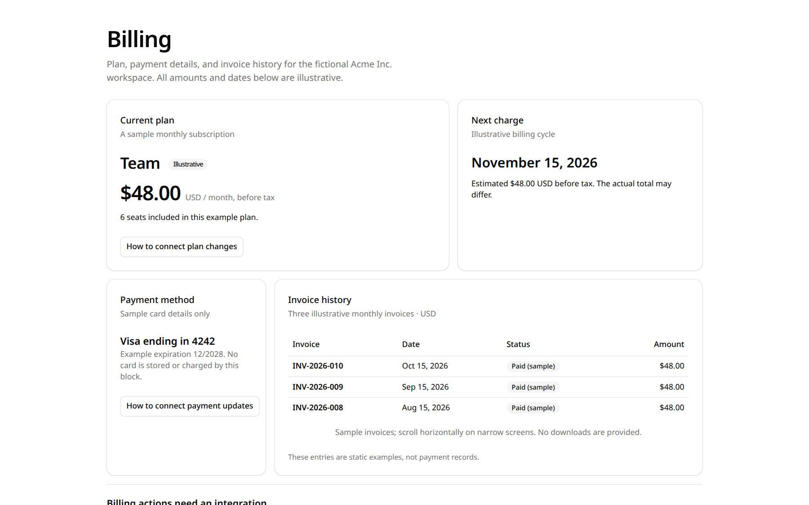</picture></a> |
| <sub>Card · Badge · Button · Table</sub><br>[Code](blocks/application/billing-01/block.html) · [Notes](blocks/application/billing-01/README.md) |

| Activity Log · `audit-log-01` |
| --- |
| <a href="blocks/application/audit-log-01/block.html"><picture><source media="(prefers-color-scheme: dark)" srcset="blocks/application/audit-log-01/preview-dark.png">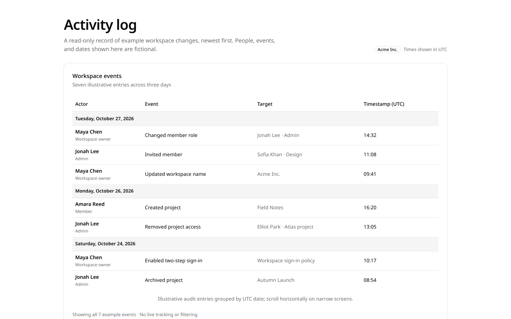</picture></a> |
| <sub>Card · Table · Badge</sub><br>[Code](blocks/application/audit-log-01/block.html) · [Notes](blocks/application/audit-log-01/README.md) |

| Notification Preferences · `notifications-01` |
| --- |
| <a href="blocks/application/notifications-01/block.html"><picture><source media="(prefers-color-scheme: dark)" srcset="blocks/application/notifications-01/preview-dark.png">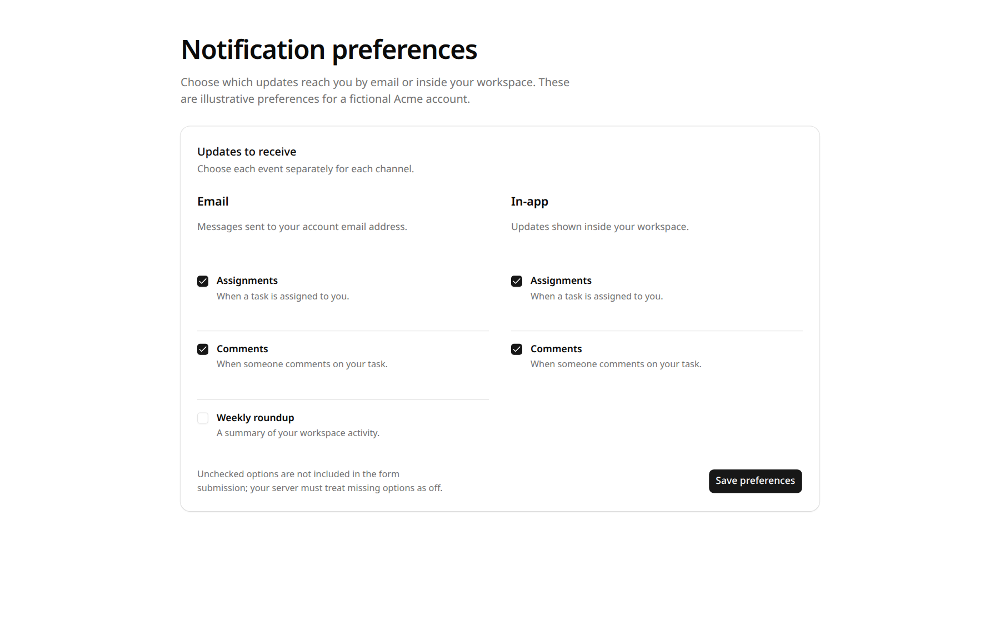</picture></a> |
| <sub>Card · Fieldset · Field · Checkbox · Button</sub><br>[Code](blocks/application/notifications-01/block.html) · [Notes](blocks/application/notifications-01/README.md) |

| Project Empty State · `empty-state-01` |
| --- |
| <a href="blocks/application/empty-state-01/block.html"><picture><source media="(prefers-color-scheme: dark)" srcset="blocks/application/empty-state-01/preview-dark.png">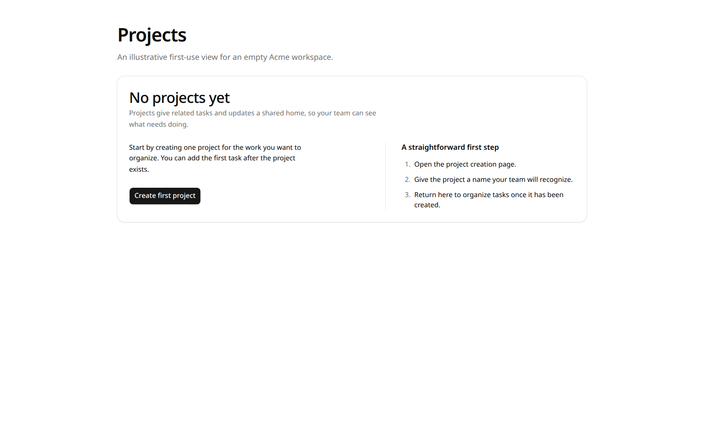</picture></a> |
| <sub>Card · Button</sub><br>[Code](blocks/application/empty-state-01/block.html) · [Notes](blocks/application/empty-state-01/README.md) |

| Workspace Setup · `onboarding-01` |
| --- |
| <a href="blocks/application/onboarding-01/block.html"><picture><source media="(prefers-color-scheme: dark)" srcset="blocks/application/onboarding-01/preview-dark.png">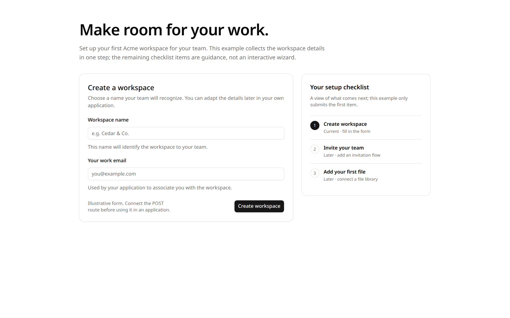</picture></a> |
| <sub>Card · Field · Input · Button</sub><br>[Code](blocks/application/onboarding-01/block.html) · [Notes](blocks/application/onboarding-01/README.md) |

| File Upload · `file-upload-01` |
| --- |
| <a href="blocks/application/file-upload-01/block.html"><picture><source media="(prefers-color-scheme: dark)" srcset="blocks/application/file-upload-01/preview-dark.png">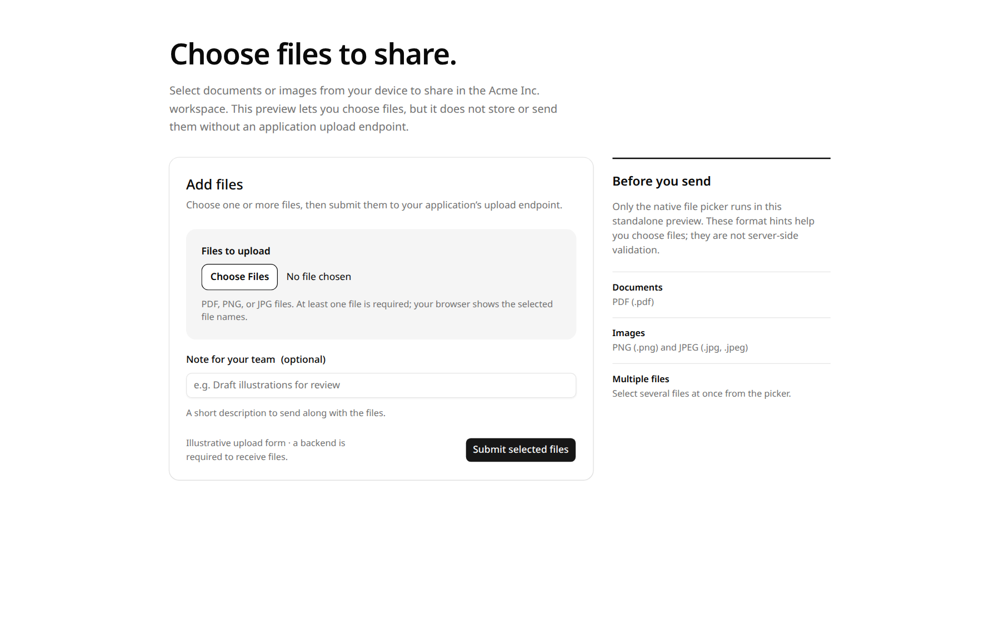</picture></a> |
| <sub>Card · Field · Input · Button</sub><br>[Code](blocks/application/file-upload-01/block.html) · [Notes](blocks/application/file-upload-01/README.md) |

| Command Menu · `command-menu-01` |
| --- |
| <a href="blocks/application/command-menu-01/block.html"><picture><source media="(prefers-color-scheme: dark)" srcset="blocks/application/command-menu-01/preview-dark.png">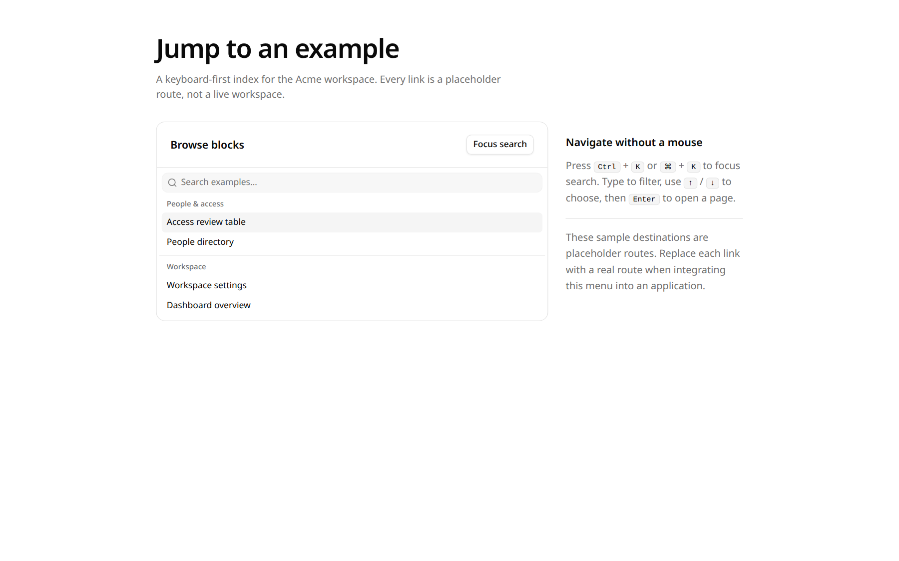</picture></a> |
| <sub>Command · Button · <b>needs Basecoat JS</b></sub><br>[Code](blocks/application/command-menu-01/block.html) · [Notes](blocks/application/command-menu-01/README.md) |

| Access Review Table · `users-table-02` |
| --- |
| <a href="blocks/application/users-table-02/block.html"><picture><source media="(prefers-color-scheme: dark)" srcset="blocks/application/users-table-02/preview-dark.png">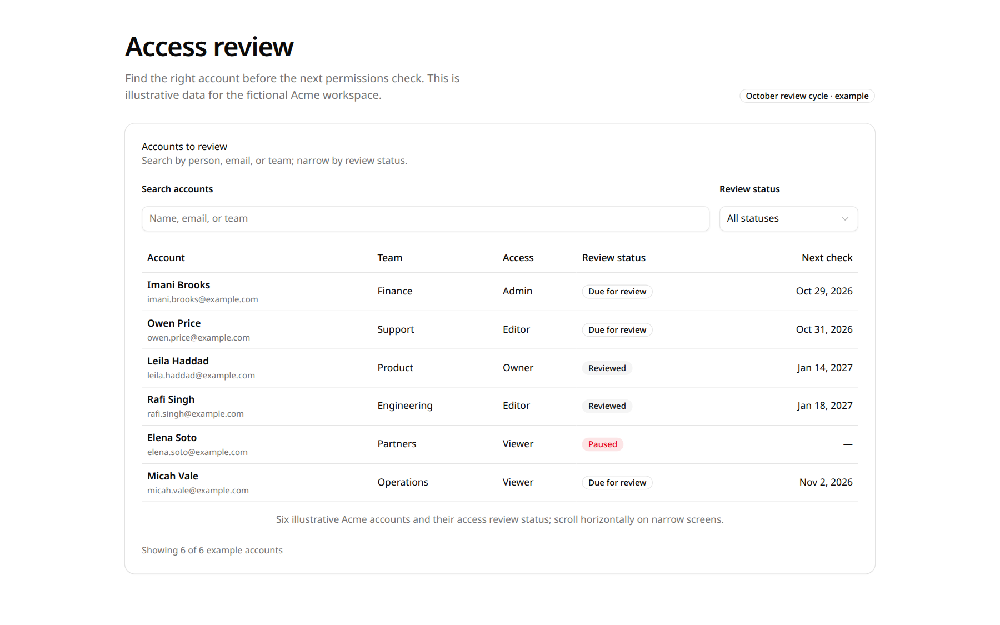</picture></a> |
| <sub>Card · Table · Input · Select · Badge</sub><br>[Code](blocks/application/users-table-02/block.html) · [Notes](blocks/application/users-table-02/README.md) |

| Assistant Chat · `chat-01` |
| --- |
| <a href="blocks/application/chat-01/block.html"><picture><source media="(prefers-color-scheme: dark)" srcset="blocks/application/chat-01/preview-dark.png">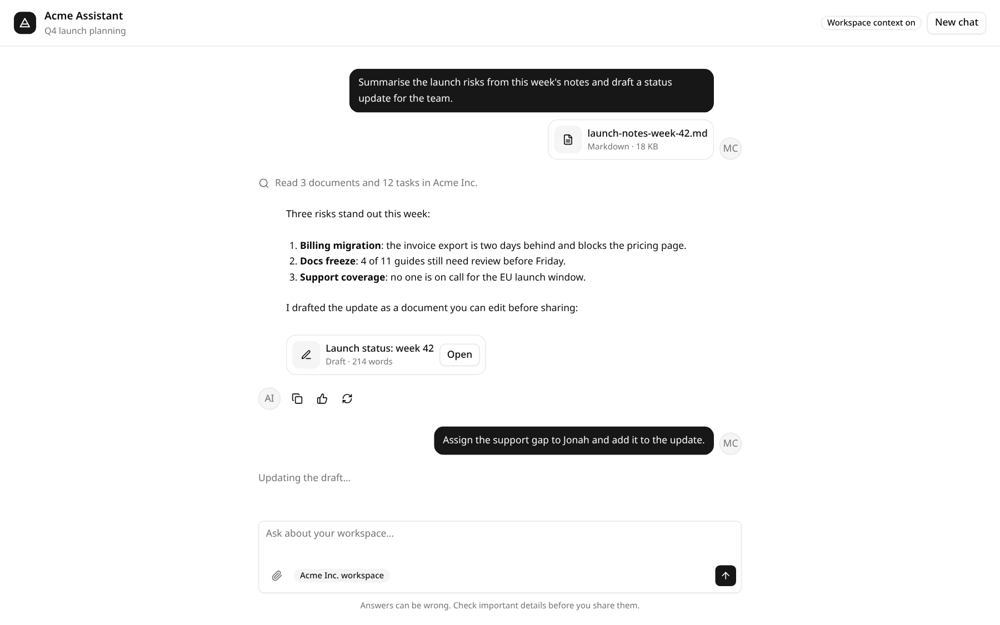</picture></a> |
| <sub>Message · Bubble · Attachment · Marker · Shimmer · Avatar · Input Group · Badge · Button</sub><br>[Code](blocks/application/chat-01/block.html) · [Notes](blocks/application/chat-01/README.md) |

| Deployment Run · `agent-run-01` |
| --- |
| <a href="blocks/application/agent-run-01/block.html"><picture><source media="(prefers-color-scheme: dark)" srcset="blocks/application/agent-run-01/preview-dark.png">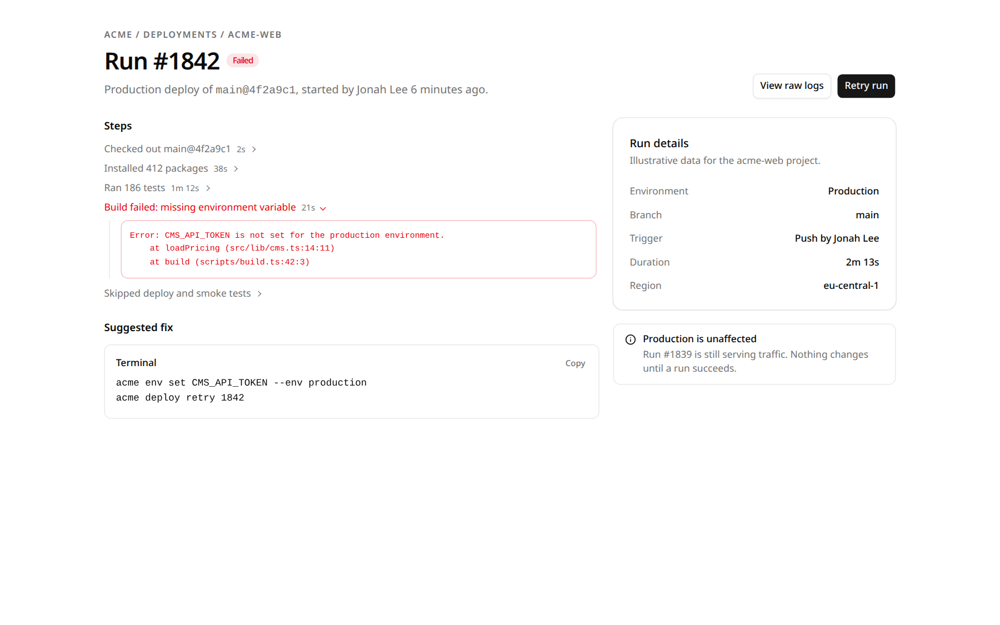</picture></a> |
| <sub>Trace · Code Block · Card · Alert · Badge · Button · <b>needs Basecoat JS</b></sub><br>[Code](blocks/application/agent-run-01/block.html) · [Notes](blocks/application/agent-run-01/README.md) |

| Orders Data Table · `data-table-01` |
| --- |
| <a href="blocks/application/data-table-01/block.html"><picture><source media="(prefers-color-scheme: dark)" srcset="blocks/application/data-table-01/preview-dark.png">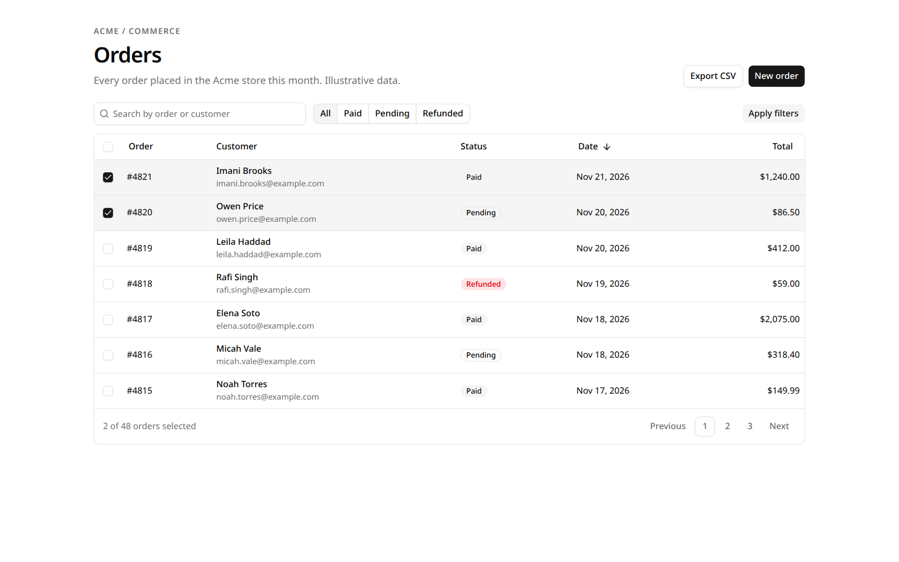</picture></a> |
| <sub>Table · Input Group · Toggle Group · Button Group · Checkbox · Badge · Button</sub><br>[Code](blocks/application/data-table-01/block.html) · [Notes](blocks/application/data-table-01/README.md) |

| Tabbed Workspace Settings · `settings-02` |
| --- |
| <a href="blocks/application/settings-02/block.html"><picture><source media="(prefers-color-scheme: dark)" srcset="blocks/application/settings-02/preview-dark.png">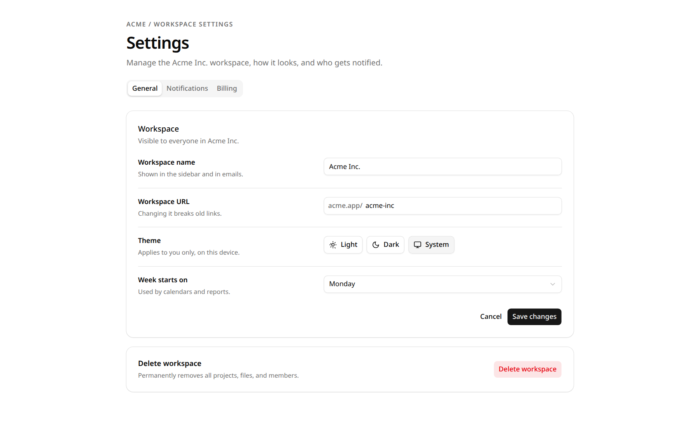</picture></a> |
| <sub>Tabs · Card · Field · Input Group · Toggle Group · Native Select · Switch · Button · <b>needs Basecoat JS</b></sub><br>[Code](blocks/application/settings-02/block.html) · [Notes](blocks/application/settings-02/README.md) |

| Kanban Board · `kanban-01` |
| --- |
| <a href="blocks/application/kanban-01/block.html"><picture><source media="(prefers-color-scheme: dark)" srcset="blocks/application/kanban-01/preview-dark.png">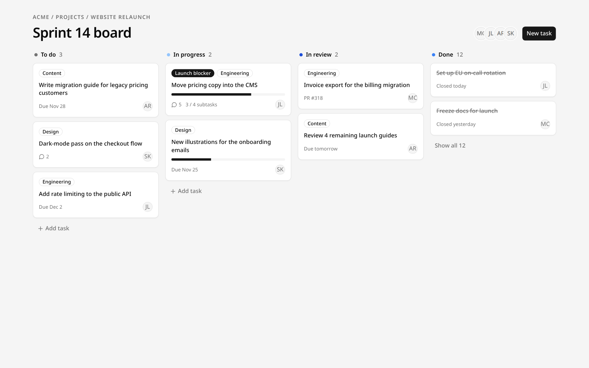</picture></a> |
| <sub>Badge · Avatar · Avatar Group · Progress · Button</sub><br>[Code](blocks/application/kanban-01/block.html) · [Notes](blocks/application/kanban-01/README.md) |

| Not Found Page · `error-404-01` |
| --- |
| <a href="blocks/application/error-404-01/block.html"><picture><source media="(prefers-color-scheme: dark)" srcset="blocks/application/error-404-01/preview-dark.png">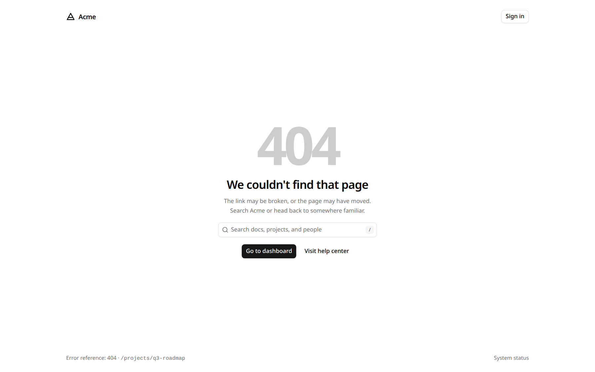</picture></a> |
| <sub>Empty · Input Group · Kbd · Button</sub><br>[Code](blocks/application/error-404-01/block.html) · [Notes](blocks/application/error-404-01/README.md) |

| Prompt Composer · `prompt-input-01` |
| --- |
| <a href="blocks/application/prompt-input-01/block.html"><picture><source media="(prefers-color-scheme: dark)" srcset="blocks/application/prompt-input-01/preview-dark.png">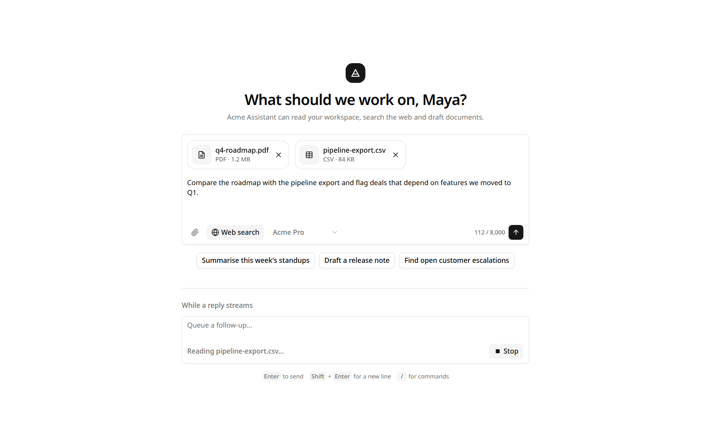</picture></a> |
| <sub>Input Group · Textarea · Attachment · Native Select · Button · Shimmer · Kbd</sub><br>[Code](blocks/application/prompt-input-01/block.html) · [Notes](blocks/application/prompt-input-01/README.md) |

| Chat with History · `chat-02` |
| --- |
| <a href="blocks/application/chat-02/block.html"><picture><source media="(prefers-color-scheme: dark)" srcset="blocks/application/chat-02/preview-dark.png">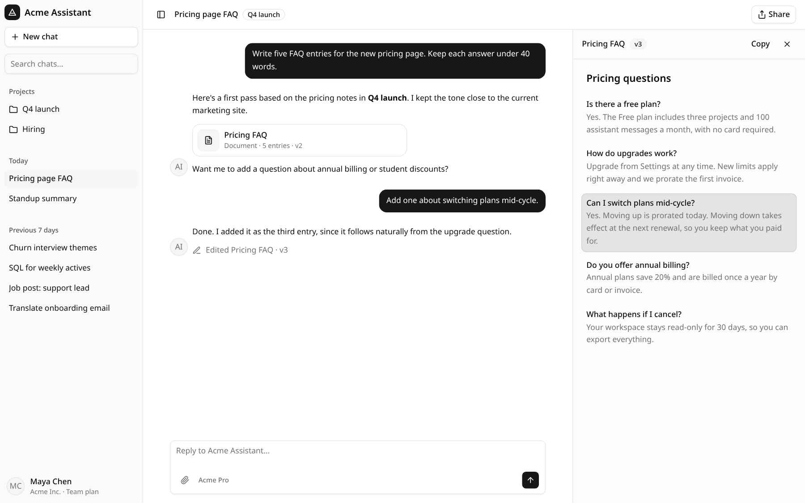</picture></a> |
| <sub>Sidebar · Message · Bubble · Attachment · Marker · Input Group · Input · Avatar · Badge · Button · <b>needs Basecoat JS</b></sub><br>[Code](blocks/application/chat-02/block.html) · [Notes](blocks/application/chat-02/README.md) |

| Agent Approval · `approval-01` |
| --- |
| <a href="blocks/application/approval-01/block.html"><picture><source media="(prefers-color-scheme: dark)" srcset="blocks/application/approval-01/preview-dark.png">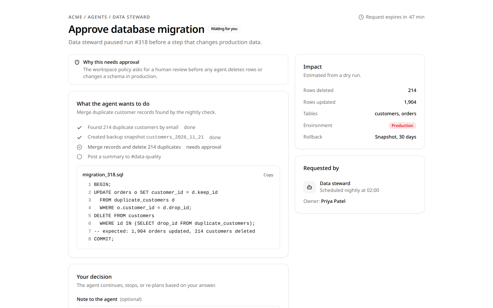</picture></a> |
| <sub>Alert · Card · Trace · Code Block · Field · Textarea · Checkbox · Badge · Button</sub><br>[Code](blocks/application/approval-01/block.html) · [Notes](blocks/application/approval-01/README.md) |

| Agents Overview · `agents-01` |
| --- |
| <a href="blocks/application/agents-01/block.html"><picture><source media="(prefers-color-scheme: dark)" srcset="blocks/application/agents-01/preview-dark.png">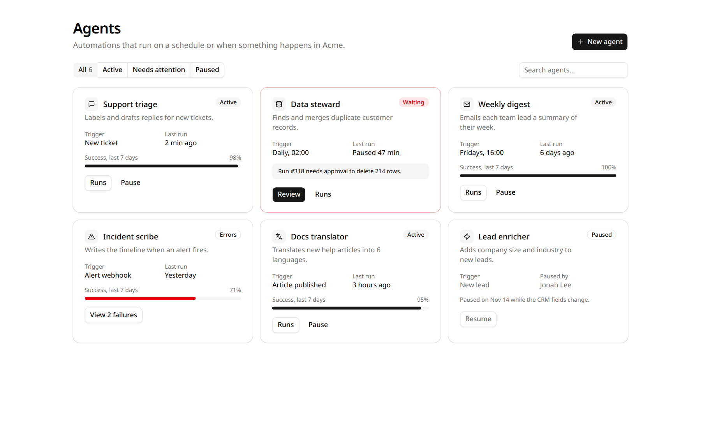</picture></a> |
| <sub>Card · Button Group · Badge · Progress · Input · Button</sub><br>[Code](blocks/application/agents-01/block.html) · [Notes](blocks/application/agents-01/README.md) |

| Assistant Settings · `assistant-settings-01` |
| --- |
| <a href="blocks/application/assistant-settings-01/block.html"><picture><source media="(prefers-color-scheme: dark)" srcset="blocks/application/assistant-settings-01/preview-dark.png">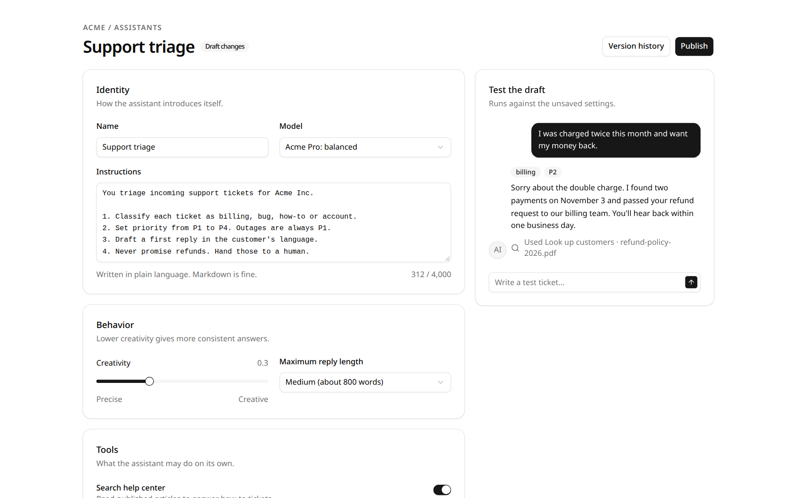</picture></a> |
| <sub>Card · Field · Input · Native Select · Textarea · Range · Switch · Item · Message · Bubble · Marker · Input Group · Avatar · Badge · Button</sub><br>[Code](blocks/application/assistant-settings-01/block.html) · [Notes](blocks/application/assistant-settings-01/README.md) |

| Knowledge Base · `knowledge-base-01` |
| --- |
| <a href="blocks/application/knowledge-base-01/block.html"><picture><source media="(prefers-color-scheme: dark)" srcset="blocks/application/knowledge-base-01/preview-dark.png">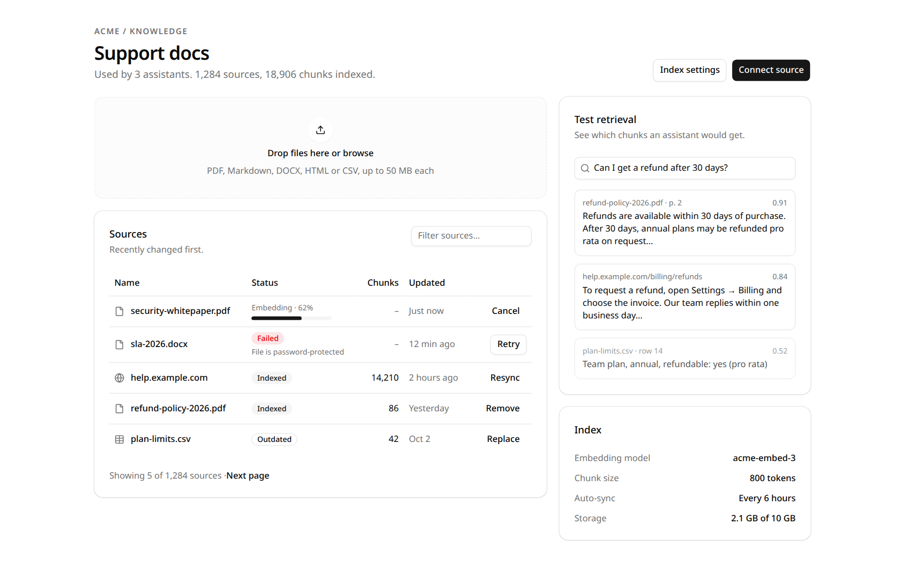</picture></a> |
| <sub>Card · Table · Progress · Badge · Input · Input Group · Button</sub><br>[Code](blocks/application/knowledge-base-01/block.html) · [Notes](blocks/application/knowledge-base-01/README.md) |

| AI Usage · `usage-01` |
| --- |
| <a href="blocks/application/usage-01/block.html"><picture><source media="(prefers-color-scheme: dark)" srcset="blocks/application/usage-01/preview-dark.png">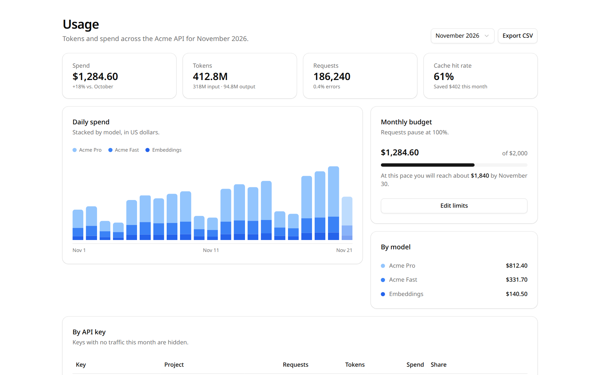</picture></a> |
| <sub>Card · Native Select · Progress · Table · Button</sub><br>[Code](blocks/application/usage-01/block.html) · [Notes](blocks/application/usage-01/README.md) |

| LLM Trace · `trace-01` |
| --- |
| <a href="blocks/application/trace-01/block.html"><picture><source media="(prefers-color-scheme: dark)" srcset="blocks/application/trace-01/preview-dark.png">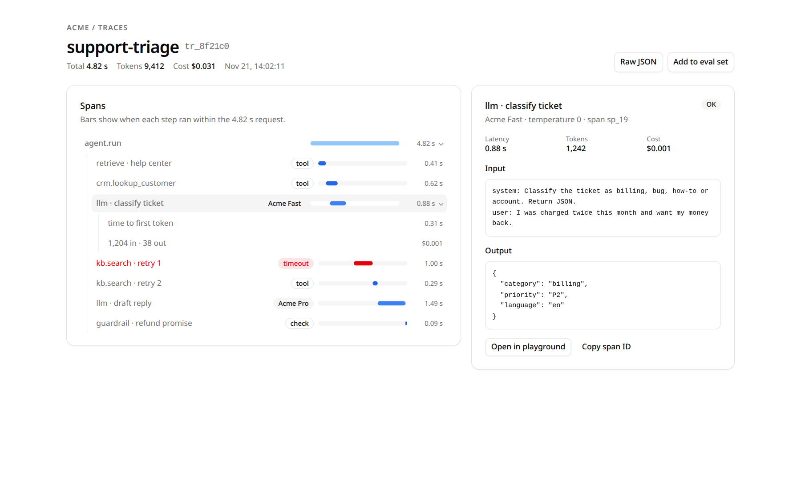</picture></a> |
| <sub>Trace · Card · Code Block · Badge · Button</sub><br>[Code](blocks/application/trace-01/block.html) · [Notes](blocks/application/trace-01/README.md) |

| Eval Results · `evals-01` |
| --- |
| <a href="blocks/application/evals-01/block.html"><picture><source media="(prefers-color-scheme: dark)" srcset="blocks/application/evals-01/preview-dark.png">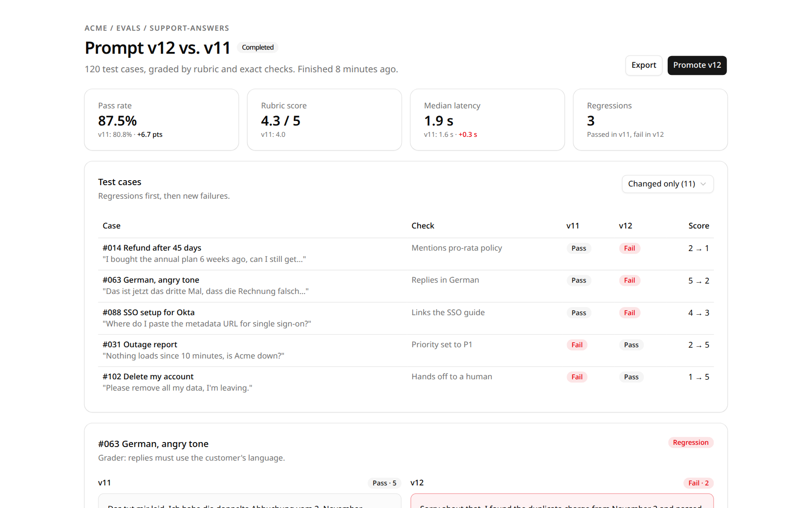</picture></a> |
| <sub>Card · Table · Badge · Native Select · Button</sub><br>[Code](blocks/application/evals-01/block.html) · [Notes](blocks/application/evals-01/README.md) |

| AI Search Results · `ai-search-01` |
| --- |
| <a href="blocks/application/ai-search-01/block.html"><picture><source media="(prefers-color-scheme: dark)" srcset="blocks/application/ai-search-01/preview-dark.png">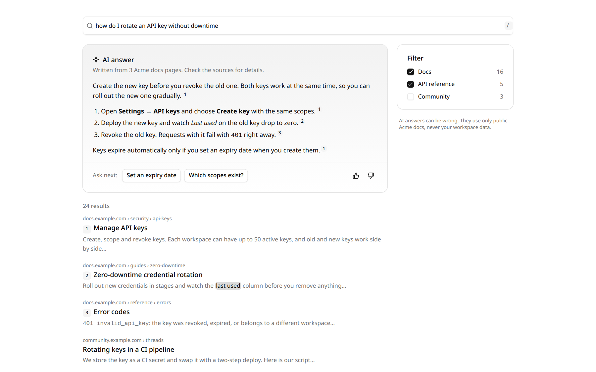</picture></a> |
| <sub>Card · Input Group · Kbd · Checkbox · Button</sub><br>[Code](blocks/application/ai-search-01/block.html) · [Notes](blocks/application/ai-search-01/README.md) |

| Inline AI Editing · `inline-ai-01` |
| --- |
| <a href="blocks/application/inline-ai-01/block.html"><picture><source media="(prefers-color-scheme: dark)" srcset="blocks/application/inline-ai-01/preview-dark.png">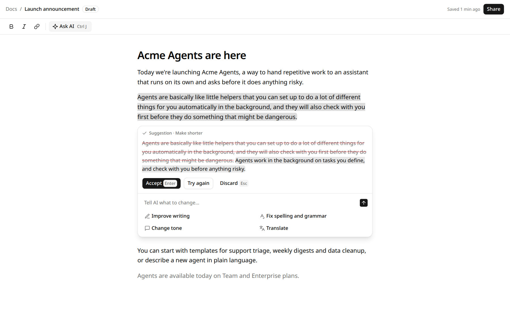</picture></a> |
| <sub>Input Group · Kbd · Badge · Button</sub><br>[Code](blocks/application/inline-ai-01/block.html) · [Notes](blocks/application/inline-ai-01/README.md) |

| New Issue Form · `issue-form-01` |
| --- |
| <a href="blocks/application/issue-form-01/block.html"><picture><source media="(prefers-color-scheme: dark)" srcset="blocks/application/issue-form-01/preview-dark.png">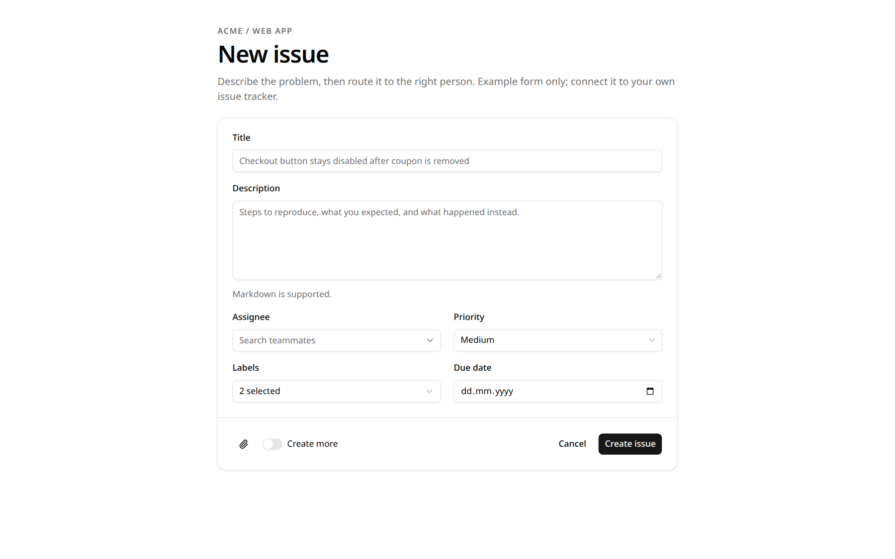</picture></a> |
| <sub>Card · Field · Input · Textarea · Combobox · Select · Popover · Checkbox · Switch · Tooltip · Button · <b>needs Basecoat JS</b></sub><br>[Code](blocks/application/issue-form-01/block.html) · [Notes](blocks/application/issue-form-01/README.md) |

| Order Detail · `order-detail-01` |
| --- |
| <a href="blocks/application/order-detail-01/block.html"><picture><source media="(prefers-color-scheme: dark)" srcset="blocks/application/order-detail-01/preview-dark.png">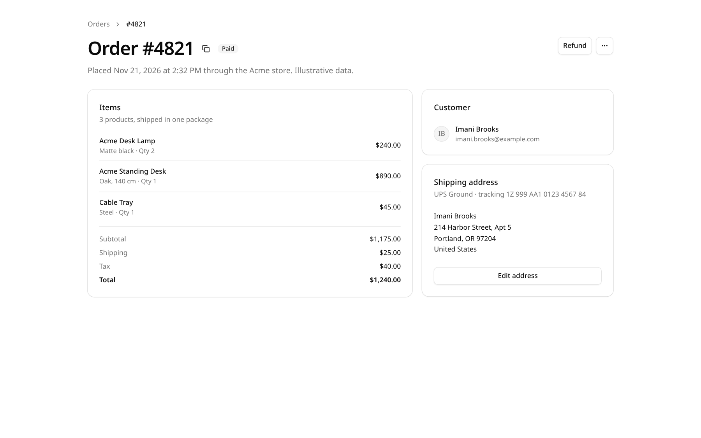</picture></a> |
| <sub>Breadcrumb · Card · Badge · Avatar · Button · Tooltip · Toast · Dropdown Menu · Alert Dialog · Sheet · Field · Input · Native Select · <b>needs Basecoat JS</b></sub><br>[Code](blocks/application/order-detail-01/block.html) · [Notes](blocks/application/order-detail-01/README.md) |

| Loading Skeletons · `loading-01` |
| --- |
| <a href="blocks/application/loading-01/block.html"><picture><source media="(prefers-color-scheme: dark)" srcset="blocks/application/loading-01/preview-dark.png">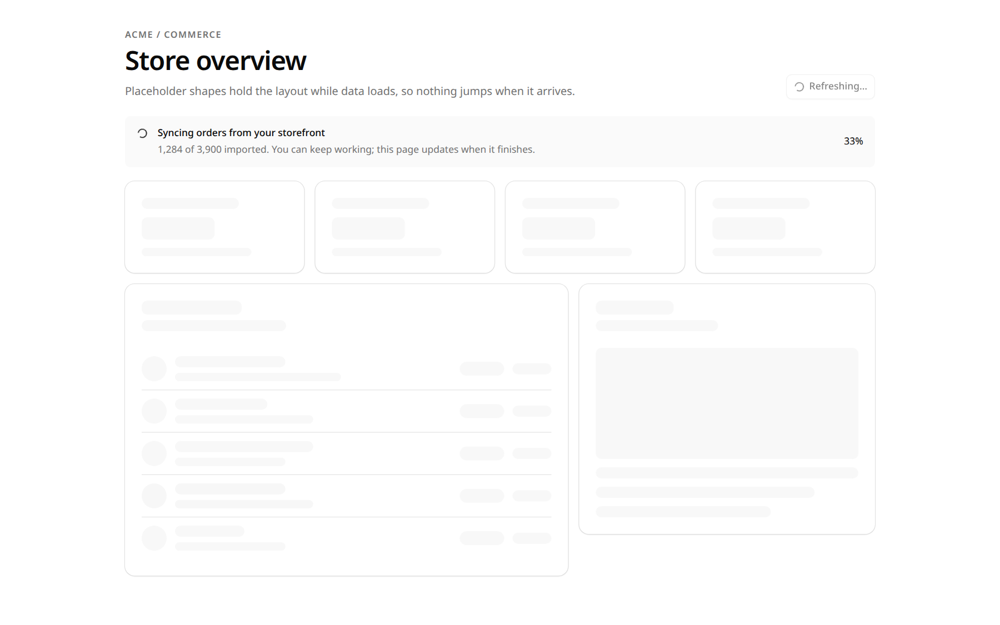</picture></a> |
| <sub>Skeleton · Spinner · Item · Card · Button</sub><br>[Code](blocks/application/loading-01/block.html) · [Notes](blocks/application/loading-01/README.md) |

| Product Filters Drawer · `filters-01` |
| --- |
| <a href="blocks/application/filters-01/block.html"><picture><source media="(prefers-color-scheme: dark)" srcset="blocks/application/filters-01/preview-dark.png">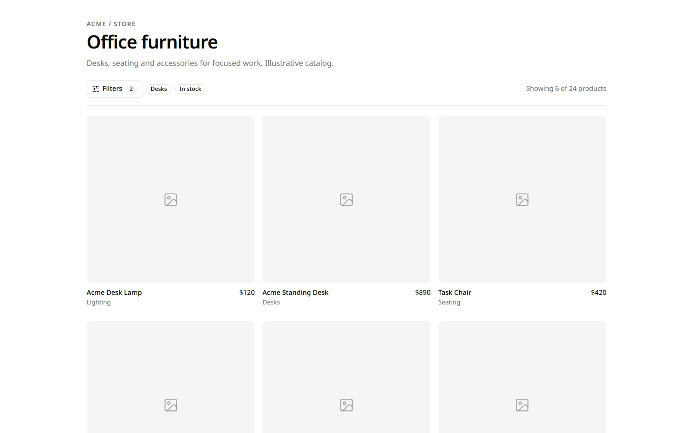</picture></a> |
| <sub>Drawer · Checkbox · Radio Group · Range · Switch · Field · Badge · Button · <b>needs Basecoat JS</b></sub><br>[Code](blocks/application/filters-01/block.html) · [Notes](blocks/application/filters-01/README.md) |

### Marketing

8 blocks · [category notes](blocks/marketing/README.md) · [back to top](#basecoat-blocks)

| SaaS Hero · `hero-01` |
| --- |
| <a href="blocks/marketing/hero-01/block.html"><picture><source media="(prefers-color-scheme: dark)" srcset="blocks/marketing/hero-01/preview-dark.png">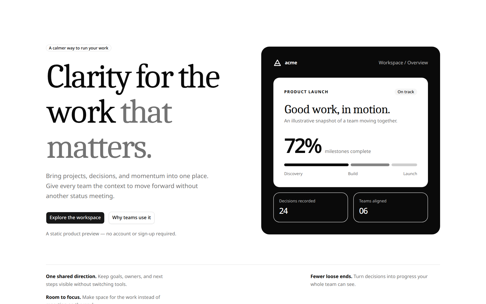</picture></a> |
| <sub>Button · Badge</sub><br>[Code](blocks/marketing/hero-01/block.html) · [Notes](blocks/marketing/hero-01/README.md) |

| Pricing Section · `pricing-01` |
| --- |
| <a href="blocks/marketing/pricing-01/block.html"><picture><source media="(prefers-color-scheme: dark)" srcset="blocks/marketing/pricing-01/preview-dark.png">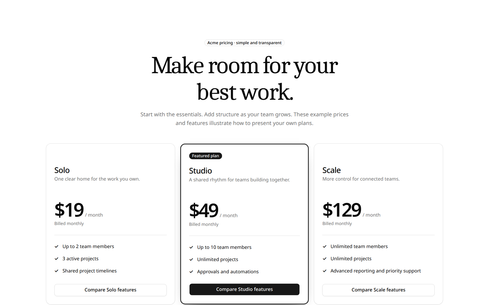</picture></a> |
| <sub>Card · Button · Badge · Table</sub><br>[Code](blocks/marketing/pricing-01/block.html) · [Notes](blocks/marketing/pricing-01/README.md) |

| Feature Grid · `features-01` |
| --- |
| <a href="blocks/marketing/features-01/block.html"><picture><source media="(prefers-color-scheme: dark)" srcset="blocks/marketing/features-01/preview-dark.png">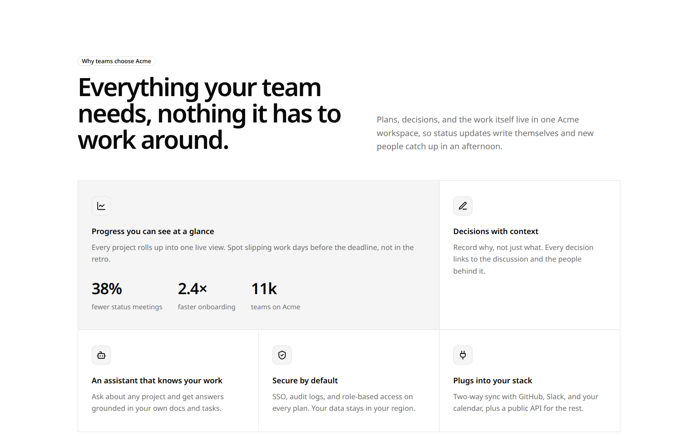</picture></a> |
| <sub>Badge</sub><br>[Code](blocks/marketing/features-01/block.html) · [Notes](blocks/marketing/features-01/README.md) |

| FAQ Section · `faq-01` |
| --- |
| <a href="blocks/marketing/faq-01/block.html"><picture><source media="(prefers-color-scheme: dark)" srcset="blocks/marketing/faq-01/preview-dark.png">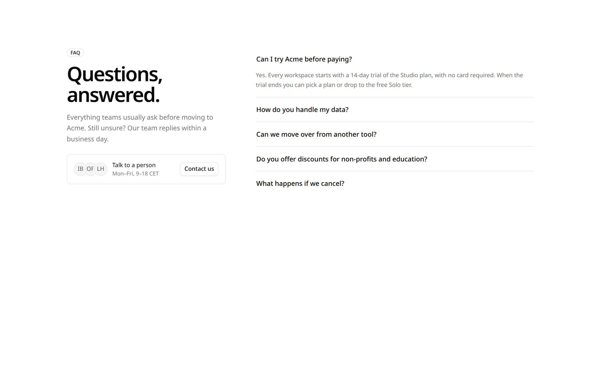</picture></a> |
| <sub>Accordion · Avatar Group · Badge · Button · <b>needs Basecoat JS</b></sub><br>[Code](blocks/marketing/faq-01/block.html) · [Notes](blocks/marketing/faq-01/README.md) |

| Testimonials Carousel · `testimonials-01` |
| --- |
| <a href="blocks/marketing/testimonials-01/block.html"><picture><source media="(prefers-color-scheme: dark)" srcset="blocks/marketing/testimonials-01/preview-dark.png">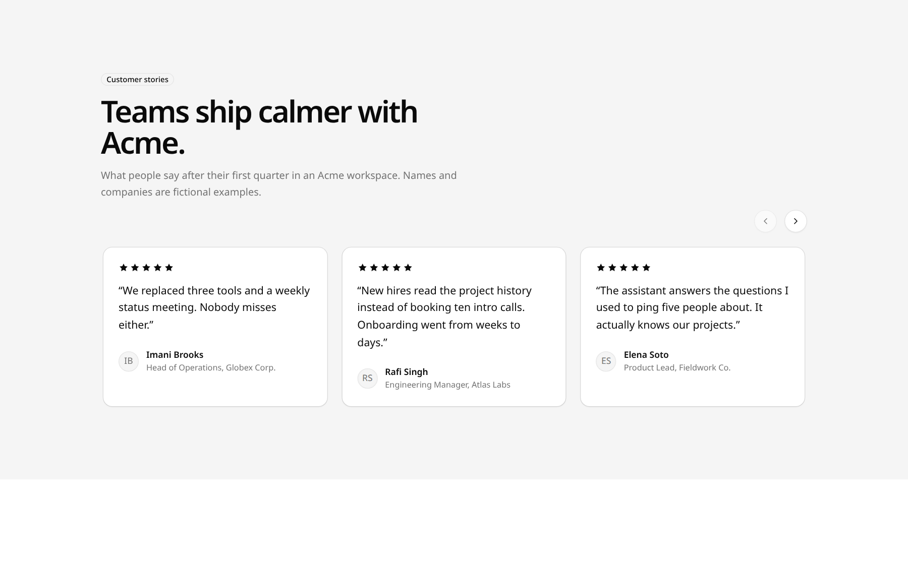</picture></a> |
| <sub>Carousel · Card · Avatar · Badge · Button · <b>needs Basecoat JS</b></sub><br>[Code](blocks/marketing/testimonials-01/block.html) · [Notes](blocks/marketing/testimonials-01/README.md) |

| Footer with CTA · `footer-01` |
| --- |
| <a href="blocks/marketing/footer-01/block.html"><picture><source media="(prefers-color-scheme: dark)" srcset="blocks/marketing/footer-01/preview-dark.png">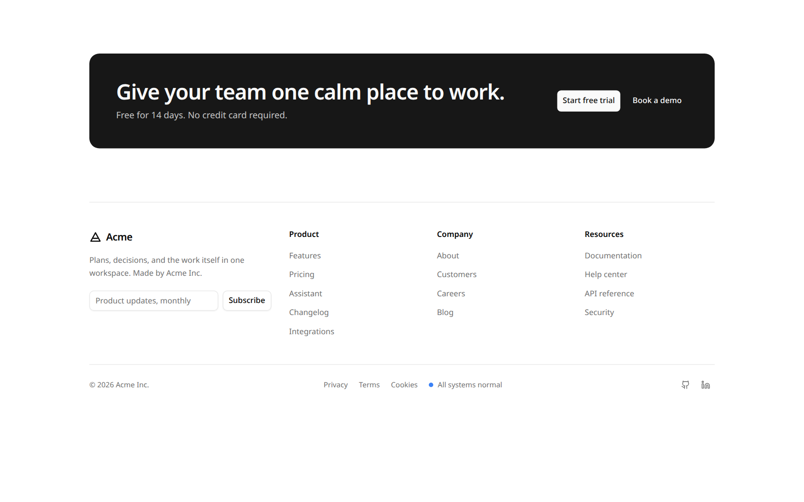</picture></a> |
| <sub>Input · Button</sub><br>[Code](blocks/marketing/footer-01/block.html) · [Notes](blocks/marketing/footer-01/README.md) |

| AI Product Hero · `hero-02` |
| --- |
| <a href="blocks/marketing/hero-02/block.html"><picture><source media="(prefers-color-scheme: dark)" srcset="blocks/marketing/hero-02/preview-dark.png">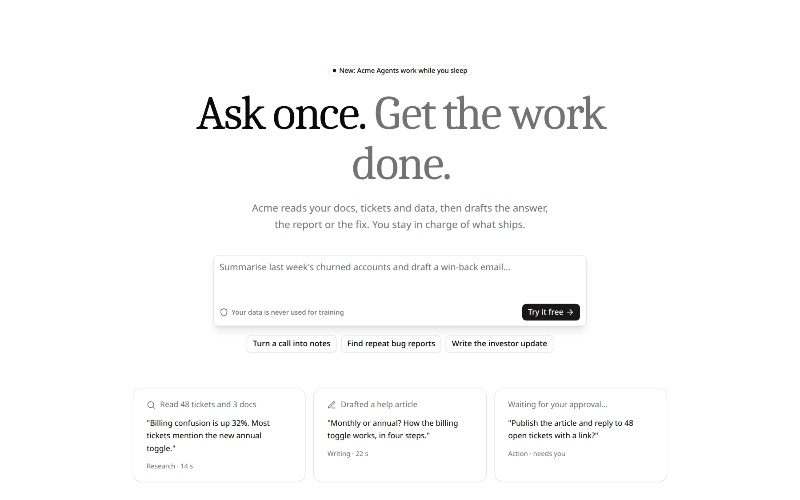</picture></a> |
| <sub>Input Group · Textarea · Card · Marker · Shimmer · Badge · Button</sub><br>[Code](blocks/marketing/hero-02/block.html) · [Notes](blocks/marketing/hero-02/README.md) |

| Usage-Based Pricing · `pricing-02` |
| --- |
| <a href="blocks/marketing/pricing-02/block.html"><picture><source media="(prefers-color-scheme: dark)" srcset="blocks/marketing/pricing-02/preview-dark.png"></picture></a> |
| <sub>Card · Field · Range · Badge · Button</sub><br>[Code](blocks/marketing/pricing-02/block.html) · [Notes](blocks/marketing/pricing-02/README.md) |

<!-- catalog:end -->

## Find by component

<details>
<summary>Show which blocks use each Basecoat component</summary>

<!-- components:start -->
Looking for a working example of one Basecoat component? Every block that uses it:

| Component | Blocks |
| --- | --- |
| Accordion | [`faq-01`](blocks/marketing/faq-01/block.html) |
| Alert | [`forgot-password-01`](blocks/authentication/forgot-password-01/block.html) [`agent-run-01`](blocks/application/agent-run-01/block.html) [`approval-01`](blocks/application/approval-01/block.html) |
| Alert Dialog | [`team-members-01`](blocks/application/team-members-01/block.html) [`order-detail-01`](blocks/application/order-detail-01/block.html) |
| Attachment | [`chat-01`](blocks/application/chat-01/block.html) [`prompt-input-01`](blocks/application/prompt-input-01/block.html) [`chat-02`](blocks/application/chat-02/block.html) |
| Avatar | [`dashboard-01`](blocks/dashboard/dashboard-01/block.html) [`users-01`](blocks/application/users-01/block.html) [`team-members-01`](blocks/application/team-members-01/block.html) [`chat-01`](blocks/application/chat-01/block.html) [`kanban-01`](blocks/application/kanban-01/block.html) [`chat-02`](blocks/application/chat-02/block.html) [`assistant-settings-01`](blocks/application/assistant-settings-01/block.html) [`order-detail-01`](blocks/application/order-detail-01/block.html) [`testimonials-01`](blocks/marketing/testimonials-01/block.html) |
| Avatar Group | [`kanban-01`](blocks/application/kanban-01/block.html) [`faq-01`](blocks/marketing/faq-01/block.html) |
| Badge | [`sidebar-01`](blocks/sidebar/sidebar-01/block.html) [`sidebar-02`](blocks/sidebar/sidebar-02/block.html) [`sidebar-03`](blocks/sidebar/sidebar-03/block.html) [`dashboard-01`](blocks/dashboard/dashboard-01/block.html) [`settings-01`](blocks/application/settings-01/block.html) [`users-01`](blocks/application/users-01/block.html) [`api-keys-01`](blocks/application/api-keys-01/block.html) [`team-members-01`](blocks/application/team-members-01/block.html) [`billing-01`](blocks/application/billing-01/block.html) [`audit-log-01`](blocks/application/audit-log-01/block.html) [`users-table-02`](blocks/application/users-table-02/block.html) [`chat-01`](blocks/application/chat-01/block.html) [`agent-run-01`](blocks/application/agent-run-01/block.html) [`data-table-01`](blocks/application/data-table-01/block.html) [`kanban-01`](blocks/application/kanban-01/block.html) [`chat-02`](blocks/application/chat-02/block.html) [`approval-01`](blocks/application/approval-01/block.html) [`agents-01`](blocks/application/agents-01/block.html) [`assistant-settings-01`](blocks/application/assistant-settings-01/block.html) [`knowledge-base-01`](blocks/application/knowledge-base-01/block.html) [`trace-01`](blocks/application/trace-01/block.html) [`evals-01`](blocks/application/evals-01/block.html) [`inline-ai-01`](blocks/application/inline-ai-01/block.html) [`order-detail-01`](blocks/application/order-detail-01/block.html) [`filters-01`](blocks/application/filters-01/block.html) [`hero-01`](blocks/marketing/hero-01/block.html) [`pricing-01`](blocks/marketing/pricing-01/block.html) [`features-01`](blocks/marketing/features-01/block.html) [`faq-01`](blocks/marketing/faq-01/block.html) [`testimonials-01`](blocks/marketing/testimonials-01/block.html) [`hero-02`](blocks/marketing/hero-02/block.html) [`pricing-02`](blocks/marketing/pricing-02/block.html) |
| Breadcrumb | [`dashboard-01`](blocks/dashboard/dashboard-01/block.html) [`order-detail-01`](blocks/application/order-detail-01/block.html) |
| Bubble | [`chat-01`](blocks/application/chat-01/block.html) [`chat-02`](blocks/application/chat-02/block.html) [`assistant-settings-01`](blocks/application/assistant-settings-01/block.html) |
| Button | [`login-01`](blocks/authentication/login-01/block.html) [`login-02`](blocks/authentication/login-02/block.html) [`login-03`](blocks/authentication/login-03/block.html) [`signup-01`](blocks/authentication/signup-01/block.html) [`otp-01`](blocks/authentication/otp-01/block.html) [`forgot-password-01`](blocks/authentication/forgot-password-01/block.html) [`sidebar-01`](blocks/sidebar/sidebar-01/block.html) [`sidebar-02`](blocks/sidebar/sidebar-02/block.html) [`sidebar-03`](blocks/sidebar/sidebar-03/block.html) [`settings-01`](blocks/application/settings-01/block.html) [`api-keys-01`](blocks/application/api-keys-01/block.html) [`team-members-01`](blocks/application/team-members-01/block.html) [`billing-01`](blocks/application/billing-01/block.html) [`notifications-01`](blocks/application/notifications-01/block.html) [`empty-state-01`](blocks/application/empty-state-01/block.html) [`onboarding-01`](blocks/application/onboarding-01/block.html) [`file-upload-01`](blocks/application/file-upload-01/block.html) [`command-menu-01`](blocks/application/command-menu-01/block.html) [`chat-01`](blocks/application/chat-01/block.html) [`agent-run-01`](blocks/application/agent-run-01/block.html) [`data-table-01`](blocks/application/data-table-01/block.html) [`settings-02`](blocks/application/settings-02/block.html) [`kanban-01`](blocks/application/kanban-01/block.html) [`error-404-01`](blocks/application/error-404-01/block.html) [`prompt-input-01`](blocks/application/prompt-input-01/block.html) [`chat-02`](blocks/application/chat-02/block.html) [`approval-01`](blocks/application/approval-01/block.html) [`agents-01`](blocks/application/agents-01/block.html) [`assistant-settings-01`](blocks/application/assistant-settings-01/block.html) [`knowledge-base-01`](blocks/application/knowledge-base-01/block.html) [`usage-01`](blocks/application/usage-01/block.html) [`trace-01`](blocks/application/trace-01/block.html) [`evals-01`](blocks/application/evals-01/block.html) [`ai-search-01`](blocks/application/ai-search-01/block.html) [`inline-ai-01`](blocks/application/inline-ai-01/block.html) [`issue-form-01`](blocks/application/issue-form-01/block.html) [`order-detail-01`](blocks/application/order-detail-01/block.html) [`loading-01`](blocks/application/loading-01/block.html) [`filters-01`](blocks/application/filters-01/block.html) [`hero-01`](blocks/marketing/hero-01/block.html) [`pricing-01`](blocks/marketing/pricing-01/block.html) [`faq-01`](blocks/marketing/faq-01/block.html) [`testimonials-01`](blocks/marketing/testimonials-01/block.html) [`footer-01`](blocks/marketing/footer-01/block.html) [`hero-02`](blocks/marketing/hero-02/block.html) [`pricing-02`](blocks/marketing/pricing-02/block.html) |
| Button Group | [`data-table-01`](blocks/application/data-table-01/block.html) [`agents-01`](blocks/application/agents-01/block.html) |
| Card | [`login-03`](blocks/authentication/login-03/block.html) [`signup-01`](blocks/authentication/signup-01/block.html) [`otp-01`](blocks/authentication/otp-01/block.html) [`sidebar-01`](blocks/sidebar/sidebar-01/block.html) [`sidebar-02`](blocks/sidebar/sidebar-02/block.html) [`dashboard-01`](blocks/dashboard/dashboard-01/block.html) [`settings-01`](blocks/application/settings-01/block.html) [`users-01`](blocks/application/users-01/block.html) [`api-keys-01`](blocks/application/api-keys-01/block.html) [`team-members-01`](blocks/application/team-members-01/block.html) [`billing-01`](blocks/application/billing-01/block.html) [`audit-log-01`](blocks/application/audit-log-01/block.html) [`notifications-01`](blocks/application/notifications-01/block.html) [`empty-state-01`](blocks/application/empty-state-01/block.html) [`onboarding-01`](blocks/application/onboarding-01/block.html) [`file-upload-01`](blocks/application/file-upload-01/block.html) [`users-table-02`](blocks/application/users-table-02/block.html) [`agent-run-01`](blocks/application/agent-run-01/block.html) [`settings-02`](blocks/application/settings-02/block.html) [`approval-01`](blocks/application/approval-01/block.html) [`agents-01`](blocks/application/agents-01/block.html) [`assistant-settings-01`](blocks/application/assistant-settings-01/block.html) [`knowledge-base-01`](blocks/application/knowledge-base-01/block.html) [`usage-01`](blocks/application/usage-01/block.html) [`trace-01`](blocks/application/trace-01/block.html) [`evals-01`](blocks/application/evals-01/block.html) [`ai-search-01`](blocks/application/ai-search-01/block.html) [`issue-form-01`](blocks/application/issue-form-01/block.html) [`order-detail-01`](blocks/application/order-detail-01/block.html) [`loading-01`](blocks/application/loading-01/block.html) [`pricing-01`](blocks/marketing/pricing-01/block.html) [`testimonials-01`](blocks/marketing/testimonials-01/block.html) [`hero-02`](blocks/marketing/hero-02/block.html) [`pricing-02`](blocks/marketing/pricing-02/block.html) |
| Carousel | [`testimonials-01`](blocks/marketing/testimonials-01/block.html) |
| Checkbox | [`login-01`](blocks/authentication/login-01/block.html) [`login-02`](blocks/authentication/login-02/block.html) [`login-03`](blocks/authentication/login-03/block.html) [`signup-01`](blocks/authentication/signup-01/block.html) [`notifications-01`](blocks/application/notifications-01/block.html) [`data-table-01`](blocks/application/data-table-01/block.html) [`approval-01`](blocks/application/approval-01/block.html) [`ai-search-01`](blocks/application/ai-search-01/block.html) [`issue-form-01`](blocks/application/issue-form-01/block.html) [`filters-01`](blocks/application/filters-01/block.html) |
| Code Block | [`agent-run-01`](blocks/application/agent-run-01/block.html) [`approval-01`](blocks/application/approval-01/block.html) [`trace-01`](blocks/application/trace-01/block.html) |
| Combobox | [`issue-form-01`](blocks/application/issue-form-01/block.html) |
| Command | [`command-menu-01`](blocks/application/command-menu-01/block.html) |
| Drawer | [`filters-01`](blocks/application/filters-01/block.html) |
| Dropdown Menu | [`dashboard-01`](blocks/dashboard/dashboard-01/block.html) [`team-members-01`](blocks/application/team-members-01/block.html) [`order-detail-01`](blocks/application/order-detail-01/block.html) |
| Empty | [`error-404-01`](blocks/application/error-404-01/block.html) |
| Field | [`login-01`](blocks/authentication/login-01/block.html) [`login-02`](blocks/authentication/login-02/block.html) [`login-03`](blocks/authentication/login-03/block.html) [`signup-01`](blocks/authentication/signup-01/block.html) [`otp-01`](blocks/authentication/otp-01/block.html) [`forgot-password-01`](blocks/authentication/forgot-password-01/block.html) [`settings-01`](blocks/application/settings-01/block.html) [`api-keys-01`](blocks/application/api-keys-01/block.html) [`team-members-01`](blocks/application/team-members-01/block.html) [`notifications-01`](blocks/application/notifications-01/block.html) [`onboarding-01`](blocks/application/onboarding-01/block.html) [`file-upload-01`](blocks/application/file-upload-01/block.html) [`settings-02`](blocks/application/settings-02/block.html) [`approval-01`](blocks/application/approval-01/block.html) [`assistant-settings-01`](blocks/application/assistant-settings-01/block.html) [`issue-form-01`](blocks/application/issue-form-01/block.html) [`order-detail-01`](blocks/application/order-detail-01/block.html) [`filters-01`](blocks/application/filters-01/block.html) [`pricing-02`](blocks/marketing/pricing-02/block.html) |
| Fieldset | [`notifications-01`](blocks/application/notifications-01/block.html) |
| Input | [`login-01`](blocks/authentication/login-01/block.html) [`login-02`](blocks/authentication/login-02/block.html) [`login-03`](blocks/authentication/login-03/block.html) [`signup-01`](blocks/authentication/signup-01/block.html) [`forgot-password-01`](blocks/authentication/forgot-password-01/block.html) [`settings-01`](blocks/application/settings-01/block.html) [`api-keys-01`](blocks/application/api-keys-01/block.html) [`team-members-01`](blocks/application/team-members-01/block.html) [`onboarding-01`](blocks/application/onboarding-01/block.html) [`file-upload-01`](blocks/application/file-upload-01/block.html) [`users-table-02`](blocks/application/users-table-02/block.html) [`chat-02`](blocks/application/chat-02/block.html) [`agents-01`](blocks/application/agents-01/block.html) [`assistant-settings-01`](blocks/application/assistant-settings-01/block.html) [`knowledge-base-01`](blocks/application/knowledge-base-01/block.html) [`issue-form-01`](blocks/application/issue-form-01/block.html) [`order-detail-01`](blocks/application/order-detail-01/block.html) [`footer-01`](blocks/marketing/footer-01/block.html) |
| Input Group | [`chat-01`](blocks/application/chat-01/block.html) [`data-table-01`](blocks/application/data-table-01/block.html) [`settings-02`](blocks/application/settings-02/block.html) [`error-404-01`](blocks/application/error-404-01/block.html) [`prompt-input-01`](blocks/application/prompt-input-01/block.html) [`chat-02`](blocks/application/chat-02/block.html) [`assistant-settings-01`](blocks/application/assistant-settings-01/block.html) [`knowledge-base-01`](blocks/application/knowledge-base-01/block.html) [`ai-search-01`](blocks/application/ai-search-01/block.html) [`inline-ai-01`](blocks/application/inline-ai-01/block.html) [`hero-02`](blocks/marketing/hero-02/block.html) |
| Input OTP | [`otp-01`](blocks/authentication/otp-01/block.html) |
| Item | [`assistant-settings-01`](blocks/application/assistant-settings-01/block.html) [`loading-01`](blocks/application/loading-01/block.html) |
| Kbd | [`error-404-01`](blocks/application/error-404-01/block.html) [`prompt-input-01`](blocks/application/prompt-input-01/block.html) [`ai-search-01`](blocks/application/ai-search-01/block.html) [`inline-ai-01`](blocks/application/inline-ai-01/block.html) |
| Marker | [`chat-01`](blocks/application/chat-01/block.html) [`chat-02`](blocks/application/chat-02/block.html) [`assistant-settings-01`](blocks/application/assistant-settings-01/block.html) [`hero-02`](blocks/marketing/hero-02/block.html) |
| Message | [`chat-01`](blocks/application/chat-01/block.html) [`chat-02`](blocks/application/chat-02/block.html) [`assistant-settings-01`](blocks/application/assistant-settings-01/block.html) |
| Native Select | [`settings-01`](blocks/application/settings-01/block.html) [`api-keys-01`](blocks/application/api-keys-01/block.html) [`team-members-01`](blocks/application/team-members-01/block.html) [`settings-02`](blocks/application/settings-02/block.html) [`prompt-input-01`](blocks/application/prompt-input-01/block.html) [`assistant-settings-01`](blocks/application/assistant-settings-01/block.html) [`usage-01`](blocks/application/usage-01/block.html) [`evals-01`](blocks/application/evals-01/block.html) [`order-detail-01`](blocks/application/order-detail-01/block.html) |
| Popover | [`issue-form-01`](blocks/application/issue-form-01/block.html) |
| Progress | [`dashboard-01`](blocks/dashboard/dashboard-01/block.html) [`kanban-01`](blocks/application/kanban-01/block.html) [`agents-01`](blocks/application/agents-01/block.html) [`knowledge-base-01`](blocks/application/knowledge-base-01/block.html) [`usage-01`](blocks/application/usage-01/block.html) |
| Radio Group | [`filters-01`](blocks/application/filters-01/block.html) |
| Range | [`assistant-settings-01`](blocks/application/assistant-settings-01/block.html) [`filters-01`](blocks/application/filters-01/block.html) [`pricing-02`](blocks/marketing/pricing-02/block.html) |
| Select | [`users-table-02`](blocks/application/users-table-02/block.html) [`issue-form-01`](blocks/application/issue-form-01/block.html) |
| Sheet | [`order-detail-01`](blocks/application/order-detail-01/block.html) |
| Shimmer | [`chat-01`](blocks/application/chat-01/block.html) [`prompt-input-01`](blocks/application/prompt-input-01/block.html) [`hero-02`](blocks/marketing/hero-02/block.html) |
| Sidebar | [`sidebar-01`](blocks/sidebar/sidebar-01/block.html) [`sidebar-02`](blocks/sidebar/sidebar-02/block.html) [`sidebar-03`](blocks/sidebar/sidebar-03/block.html) [`chat-02`](blocks/application/chat-02/block.html) |
| Skeleton | [`loading-01`](blocks/application/loading-01/block.html) |
| Spinner | [`loading-01`](blocks/application/loading-01/block.html) |
| Switch | [`settings-01`](blocks/application/settings-01/block.html) [`settings-02`](blocks/application/settings-02/block.html) [`assistant-settings-01`](blocks/application/assistant-settings-01/block.html) [`issue-form-01`](blocks/application/issue-form-01/block.html) [`filters-01`](blocks/application/filters-01/block.html) |
| Table | [`dashboard-01`](blocks/dashboard/dashboard-01/block.html) [`users-01`](blocks/application/users-01/block.html) [`billing-01`](blocks/application/billing-01/block.html) [`audit-log-01`](blocks/application/audit-log-01/block.html) [`users-table-02`](blocks/application/users-table-02/block.html) [`data-table-01`](blocks/application/data-table-01/block.html) [`knowledge-base-01`](blocks/application/knowledge-base-01/block.html) [`usage-01`](blocks/application/usage-01/block.html) [`evals-01`](blocks/application/evals-01/block.html) [`pricing-01`](blocks/marketing/pricing-01/block.html) |
| Tabs | [`settings-02`](blocks/application/settings-02/block.html) |
| Textarea | [`prompt-input-01`](blocks/application/prompt-input-01/block.html) [`approval-01`](blocks/application/approval-01/block.html) [`assistant-settings-01`](blocks/application/assistant-settings-01/block.html) [`issue-form-01`](blocks/application/issue-form-01/block.html) [`hero-02`](blocks/marketing/hero-02/block.html) |
| Theme Switcher | [`dashboard-01`](blocks/dashboard/dashboard-01/block.html) |
| Toast | [`order-detail-01`](blocks/application/order-detail-01/block.html) |
| Toggle Group | [`data-table-01`](blocks/application/data-table-01/block.html) [`settings-02`](blocks/application/settings-02/block.html) |
| Tooltip | [`dashboard-01`](blocks/dashboard/dashboard-01/block.html) [`issue-form-01`](blocks/application/issue-form-01/block.html) [`order-detail-01`](blocks/application/order-detail-01/block.html) |
| Trace | [`agent-run-01`](blocks/application/agent-run-01/block.html) [`approval-01`](blocks/application/approval-01/block.html) [`trace-01`](blocks/application/trace-01/block.html) |

<!-- components:end -->

</details>

## Good to know

- **Static examples, not services.** Some blocks have local interactions (table search, command filtering, tabs), but none implement sign-in, billing, persistence, file storage or server requests. Each block's **Notes** say what to wire up.
- **`block.html` is the only file per block.** It is a fragment: no document shell, no asset imports, no framework code. A few blocks carry a small inline `<script>` for their local interaction.
- **Colors come from Basecoat's theme.** Blocks use semantic utilities such as `bg-muted`, `text-muted-foreground` and `border`, so they follow your Basecoat theme and dark mode (`class="dark"` on `<html>`).
- **Another Basecoat version or style?** The blocks are built and screenshotted against Basecoat 1.2.1 with its default style. Check the component docs and rendering before pasting into another setup.
- **See the blocks live without hosting:** clone the repo, run `npm install` and `npm run gallery`, then open http://localhost:4321 to click through every block in light and dark, at desktop, tablet and mobile width, and copy its code. For a single standalone page, `npm run preview -- <block-name>` prints `.cache/preview/<block-name>.html`.

## Contribute

See [CONTRIBUTING.md](CONTRIBUTING.md) for block anatomy, accessible HTML, naming, and the build and screenshot tooling (`npm run build`, `npm run screenshots`). MIT licensed; see [LICENSE](LICENSE).
