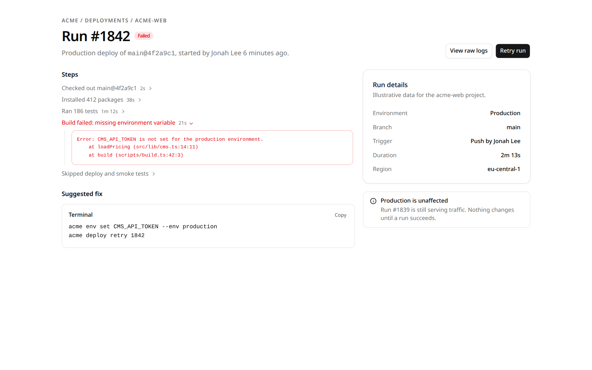

# Deployment Run — agent-run-01

A CI or agent run page: expandable step trace with timings, the failing output, a copyable fix, and run details.

<picture><source media="(prefers-color-scheme: dark)" srcset="./preview-dark.png"></picture>

**Basecoat components:** Trace, Code Block, Card, Alert, Badge, Button.

**Use:** Copy [`block.html`](./block.html) into a page that loads Tailwind CSS 4 and Basecoat 1.2.1. It needs Basecoat JavaScript: load Basecoat's `all.min.js` once in your page. Generate one `<li>` per step. `transition-details` animates each disclosure, and the failed step is rendered `open`. The Copy button uses `code-block.js` (in `all.min.js`) and the Clipboard API, which needs HTTPS or localhost.

**Design rationale:** The page answers three questions in order: what failed, why, and how to fix it. Healthy steps stay collapsed so the error is what you see first.
