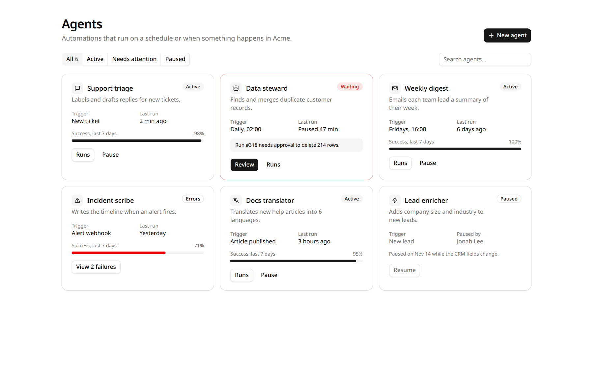

# Agents Overview — agents-01

A grid of AI agents with status, trigger, last run and 7-day success rate, plus status filters and the one action each card needs next.

<picture><source media="(prefers-color-scheme: dark)" srcset="./preview-dark.png"></picture>

**Basecoat components:** Card, Button Group, Badge, Progress, Input, Button.

**Use:** Copy [`block.html`](./block.html) into a page that loads Tailwind CSS 4 and Basecoat 1.2.1. No JavaScript is required. The filter links and the search form both send GET requests to a placeholder `/agents` route; mark the active filter with `aria-current="page"` and the secondary variant. Render one `<li class="card">` per agent. **Pause** and **Resume** should post to your own routes. All agents and numbers are illustrative.

**Design rationale:** Each card shows the one action that matters right now: "Review" for an agent waiting for approval, "View failures" for one with errors, "Resume" for a paused one. A waiting agent gets a red ring, so it stands out in a long grid. Paused agents are dimmed but stay readable.
