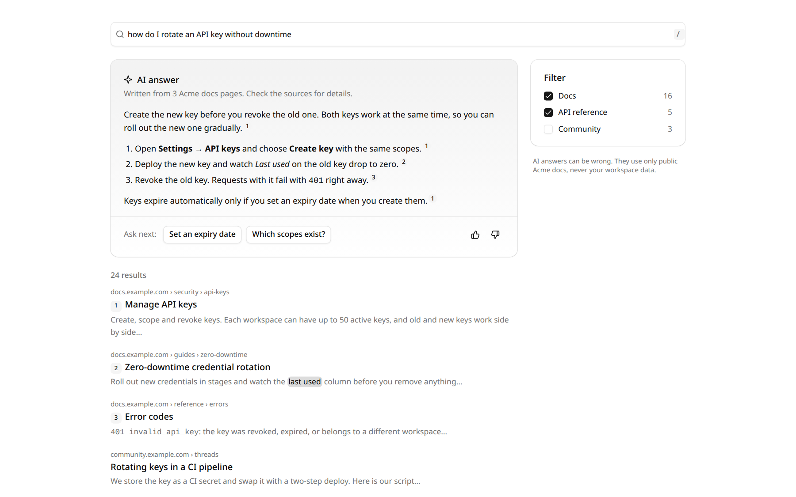

# AI Search Results — ai-search-01

A search results page with a generated answer on top: numbered citations that jump to their sources, follow-up questions, answer feedback, classic results and source filters.

<picture><source media="(prefers-color-scheme: dark)" srcset="./preview-dark.png"></picture>

**Basecoat components:** Card, Input Group, Kbd, Checkbox, Button.

**Use:** Copy [`block.html`](./block.html) into a page that loads Tailwind CSS 4 and Basecoat 1.2.1. No JavaScript is required. The search box and filters send GET requests to a placeholder `/search` route. Stream the answer into the card and give each citation an `href` that points at its result's `id`, so a citation scrolls to its source. Number the matching results the same way. Follow-up chips are plain links that run a new search. Send the thumbs up and down to your own feedback route. All content is illustrative.

**Design rationale:** The answer is short and every claim has a number, so readers can check it quickly. Cited results are numbered too, which links the answer and the list without hover tricks. The disclaimer says what data the answer uses, which is the first thing people want to know about AI search.
