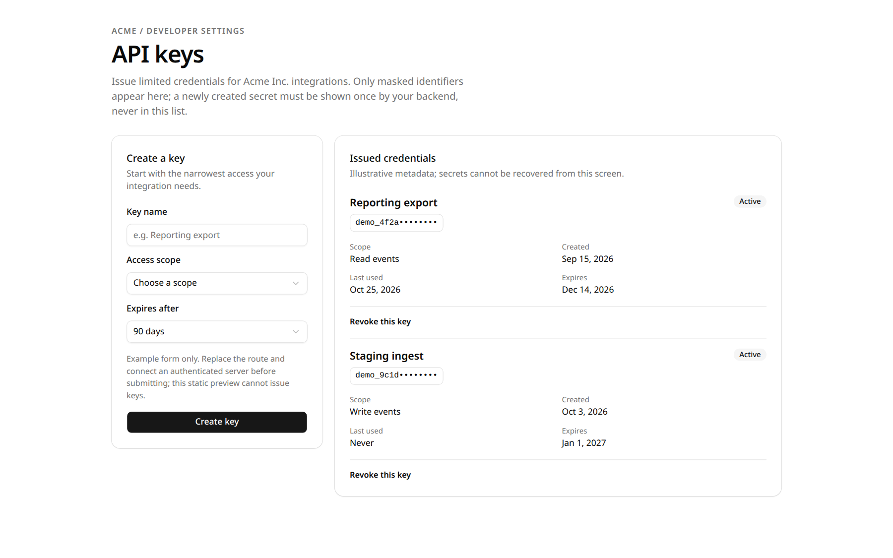

# API Keys — api-keys-01

A credential management screen with a constrained creation form, masked key identifiers, scope and lifecycle metadata, and a deliberate revoke confirmation. All keys, names, identifiers, and dates are illustrative static examples; the fragment contains **no full secrets** and cannot issue or revoke credentials by itself.

<picture><source media="(prefers-color-scheme: dark)" srcset="./preview-dark.png"></picture>

## Basecoat components

Card, Field, Input, Native Select, Button, Badge.

## Usage and integration

Copy the full contents of [`block.html`](./block.html) into a page with Tailwind CSS 4 and Basecoat 1.2.1. No JavaScript is required to open the native revoke disclosure. The preview is static: **do not submit its forms**. Their POST actions are explicit placeholders, not working API endpoints:

- `/replace-with-your-api-key-create-route` accepts `name`, `scope`, and `expires_after`. Replace with your authenticated key-creation endpoint; validate allowed scopes and expiry on the server, generate the key there, and show the secret exactly once on a secure response. Never place full secrets in the listing, HTML source, logs, or subsequent page loads.
- `/replace-with-your-api-key-revoke-route` accepts `key_id` after a user opens the native confirmation disclosure and selects **Confirm revoke**. Replace with your authenticated revocation endpoint. Resolve the key ID against the current workspace and require a CSRF token before revoking; a hidden field is not proof of authorization.

Replace example IDs, prefixes, statuses, dates, and scopes with server-provided metadata, and inject your application’s CSRF fields into both forms. Perform authorization checks for both routes, not just UI gating. The disclosure is an interaction guard, not a substitute for backend authorization or an irreversible-operation confirmation policy.

## Design rationale

Creation stays separate from existing credentials so names, scopes, and expiry are chosen deliberately. Prefixes and masked glyphs support identification without exposing secret material. Each credential shows its lifecycle independently and places destructive revocation behind a native keyboard-accessible disclosure; narrow layouts stack all controls without horizontal scrolling.
