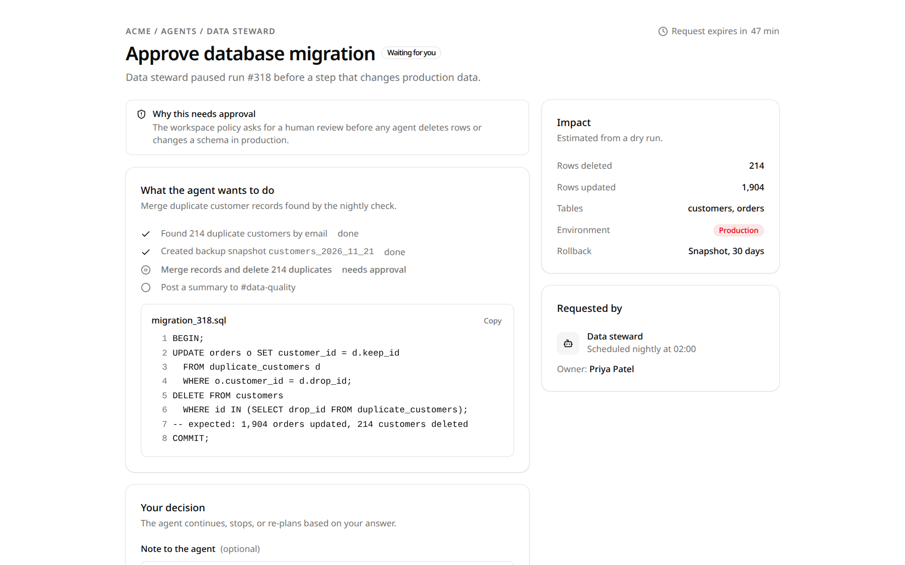

# Agent Approval — approval-01

A human-in-the-loop checkpoint: an agent pauses before a risky step and shows its plan, the exact change, the expected impact, and approve, reject, or revise actions.

<picture><source media="(prefers-color-scheme: dark)" srcset="./preview-dark.png"></picture>

**Basecoat components:** Alert, Card, Trace, Code Block, Field, Textarea, Checkbox, Badge, Button.

**Use:** Copy [`block.html`](./block.html) into a page that loads Tailwind CSS 4 and Basecoat 1.2.1. No JavaScript is required (the code block's **Copy** button only works when Basecoat JavaScript is loaded). The three submit buttons share one form and send `decision=approve|reject|revise` plus an optional `note` to a placeholder `/agents/runs/318/approval` route. Check on the server that the request has not expired and that the reviewer may approve it. Render the dry-run numbers from your agent's plan. Nothing is sent from the preview.

**Design rationale:** The reviewer sees why they are asked, what already happened, and the literal change before the buttons. The impact panel puts the environment and the rollback path next to each other, because those two decide most approvals. "Ask for changes" keeps the agent in the loop instead of forcing a yes or no.
