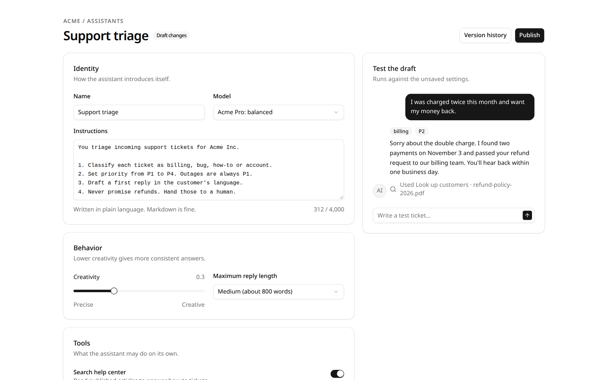

# Assistant Settings — assistant-settings-01

The configuration screen for a custom AI assistant: name, model, instructions, creativity, tool permissions, knowledge sources, and a test panel that runs against the unsaved draft.

<picture><source media="(prefers-color-scheme: dark)" srcset="./preview-dark.png"></picture>

**Basecoat components:** Card, Field, Input, Native Select, Textarea, Range, Switch, Item, Message, Bubble, Marker, Input Group, Avatar, Badge, Button.

**Use:** Copy [`block.html`](./block.html) into a page that loads Tailwind CSS 4 and Basecoat 1.2.1. No JavaScript is required. The settings form posts to a placeholder `/assistants/support-triage` route; the header's **Publish** button submits it through the `form` attribute. The test input belongs to a separate hidden form that posts to `/assistants/support-triage/preview`, so testing never saves the draft. The inline `--slider-value` paints the filled track without JavaScript; Basecoat's `range.js` keeps it in sync if you load it. Update the `<output>` on `input` in your own script. Nothing is sent from the preview.

**Design rationale:** Each tool says in one line what it lets the assistant do, and risky tools carry a "Needs approval" badge in place of a separate settings page. The test panel stays in view while you scroll, so you can change an instruction and see the effect right away.
