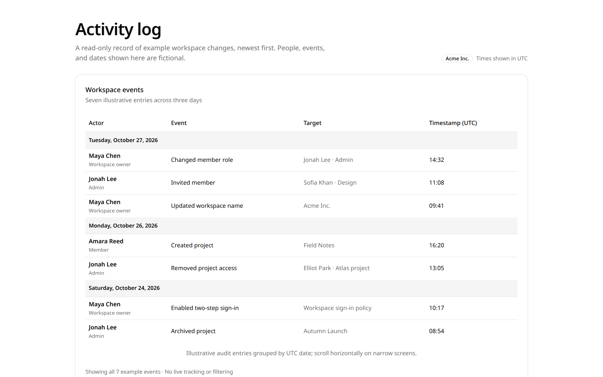

# Activity Log — audit-log-01

A dated, read-only workspace activity table with actor, event, target, and UTC timestamp. The seven entries and all names, projects, and events are fictional illustrative content; this block is **not** a security audit trail.

<picture><source media="(prefers-color-scheme: dark)" srcset="./preview-dark.png"></picture>

## Basecoat components

Card, Table, Badge.

## Usage and integration

Copy the complete [`block.html`](./block.html) fragment into a page and load Tailwind CSS 4 and Basecoat 1.2.1. No JavaScript is needed. Replace each sample row with verified event data from an authorized audit service, preserve machine-readable UTC timestamps in `<time datetime>`, and group entries by their actual UTC calendar date. Determine access, retention, pagination, and event integrity on the server. The preview has no search, filters, pagination, live refresh, or export; none are implied by the static rows.

## Design rationale

Day separators make a chronological record easier to scan without hiding the precise timestamp of each event. Explicit Actor, Event, Target, and Timestamp headings remain attached to the table; a caption communicates the time zone and mobile scrolling. No decorative controls suggest filtering functionality that does not exist.
