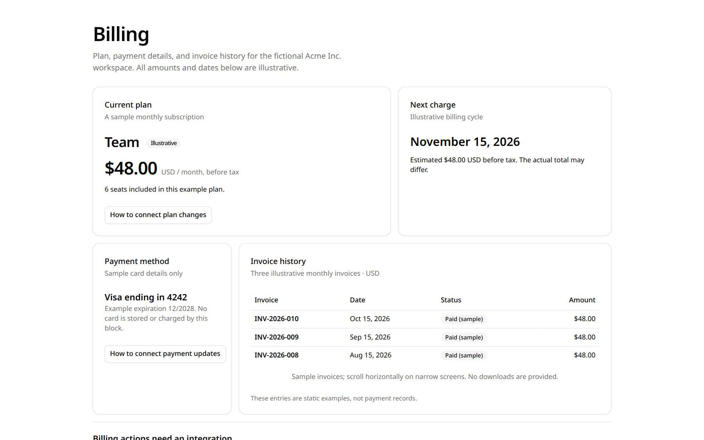

# Billing Overview — billing-01

A read-only billing screen showing a current plan, estimated next charge, example payment method, and invoice history. Acme Inc., the amounts, invoice IDs, dates, card suffix, and statuses are **illustrative**. This block does not store payment details, charge a card, download invoices, or connect to a billing provider.

<picture><source media="(prefers-color-scheme: dark)" srcset="./preview-dark.png"></picture>

## Basecoat components

Card, Badge, Button (link), Table.

## Usage and integration

Copy all of [`block.html`](./block.html) into an application page and load Tailwind CSS 4 and Basecoat 1.2.1. No JavaScript is required for the preview.

Replace the illustrative plan, seat count, estimated charge, payment method display, and invoice rows with authenticated workspace billing data. Compute totals, taxes, billing dates, and invoice status on the server or in the billing provider, not from this example. The two visible guidance links only jump to the integration note within the block; replace them with real authenticated billing-portal routes for plan changes and payment-method updates once available. Supply invoice downloads only when actual invoice URLs exist and users are authorized to access them. Do not treat the sample “Paid” labels as evidence of payment.

## Design rationale

The plan and upcoming charge sit first because they answer the two most urgent billing questions. Payment-method details and past invoices follow in separate surfaces; numerals are tabular for scanning. Visible guidance links lead to honest integration instructions rather than simulating payment controls, and the invoice table retains its column headings and caption on narrow screens.
