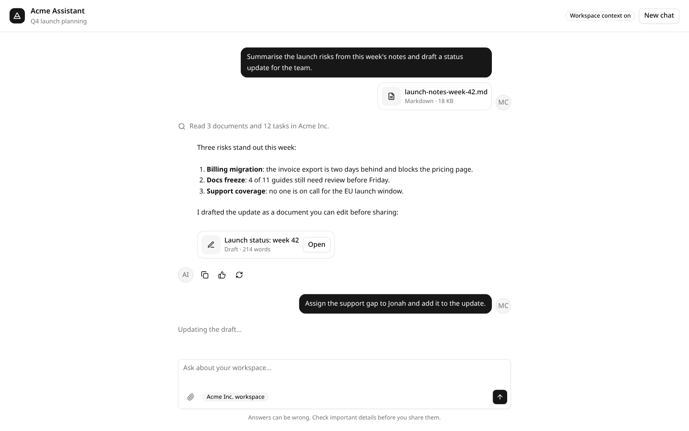

# Assistant Chat — chat-01

An AI assistant conversation with attachments, activity markers, a typing status, and a composer.

<picture><source media="(prefers-color-scheme: dark)" srcset="./preview-dark.png"></picture>

**Basecoat components:** Message, Bubble, Attachment, Marker, Shimmer, Avatar, Input Group, Badge, Button.

**Use:** Copy [`block.html`](./block.html) into a page that loads Tailwind CSS 4 and Basecoat 1.2.1. No JavaScript is required. Render each turn as an `<li class="message">`; outgoing turns get `data-align="end"`. Stream assistant replies into the answer container and announce progress with the `role="status"` marker. The composer posts to a placeholder `/assistant/messages` route. Nothing is sent from the preview.

**Design rationale:** Assistant answers sit outside bubbles so lists and documents get full width, while the user's short prompts stay as bubbles. Markers show what the assistant read, so you can judge the answer.
