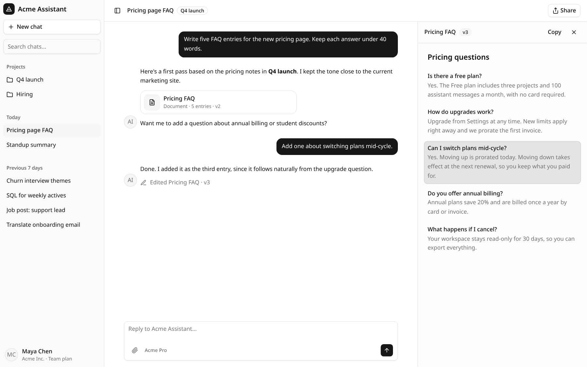

# Chat with History — chat-02

A full assistant workspace: a sidebar with projects and dated chat history, the conversation in the middle, and a side panel with the document the assistant is editing.

<picture><source media="(prefers-color-scheme: dark)" srcset="./preview-dark.png"></picture>

**Basecoat components:** Sidebar, Message, Bubble, Attachment, Marker, Input Group, Input, Avatar, Badge, Button.

**Use:** Copy [`block.html`](./block.html) into a page that loads Tailwind CSS 4, Basecoat 1.2.1 and Basecoat JavaScript (for the sidebar). Group history by date on the server and mark the open chat with `aria-current="page"`. The composer posts to a placeholder `/assistant/c/1042/messages` route, and search sends a GET to `/assistant/search`. The document panel shows from 1280 px up. Below that, open the document from the attachment card in a sheet or on its own page. Highlight the latest change, like the third FAQ entry, so people see what the assistant did. Nothing is sent from the preview.

**Design rationale:** Long output goes into the side panel, which keeps the conversation short enough to follow. The panel keeps a version number, so "v3" in a marker matches what is on screen. Projects sit above history, because people come back to them more often than to single chats.
