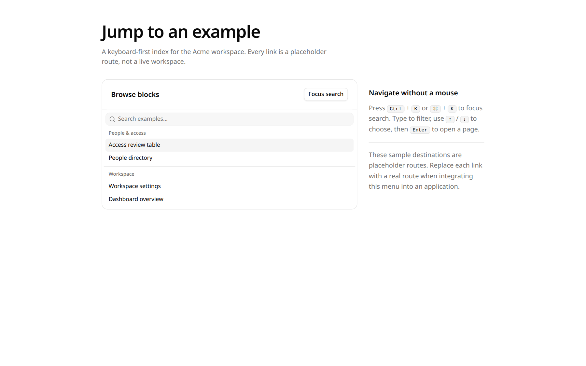

# Command Menu — command-menu-01

An always-visible, keyboard-first launcher for browsing four real local block previews. All links lead to illustrative examples, not a live workspace.

<picture><source media="(prefers-color-scheme: dark)" srcset="./preview-dark.png"></picture>

## Basecoat components

Command, Button.

## Usage and integration

Copy the full contents of [`block.html`](./block.html) into a page and load Tailwind CSS 4 with Basecoat 1.2.1 **and** Basecoat's `all.min.js` once. Basecoat's Command JavaScript handles filtering by label and keywords, arrow-key navigation, and activating the selected link with Enter; the fragment's small script adds Ctrl/⌘+K focus and the working Focus search button. Keyboard focus can also reach the links with Tab.

The sample `href` values resolve relative to this block's preview: `users-table-02`, `users-01`, `settings-01`, and `dashboard-01`. **Replace those preview links with real application routes** when embedding the fragment elsewhere; don't retain relative preview paths in production. If adding a second instance to one document, give the command, input, list, groups, focus button, and script selectors unique IDs and scope the global shortcut. No backend, command execution, or application routing is included.

## Design rationale

The search and actual destinations remain visible instead of hiding the only meaningful content behind a modal. Groups make access-related examples distinct from general workspace views. The keyboard guide stays beside the menu at desktop widths and follows it on mobile, while native anchor links make activation lead somewhere real.
