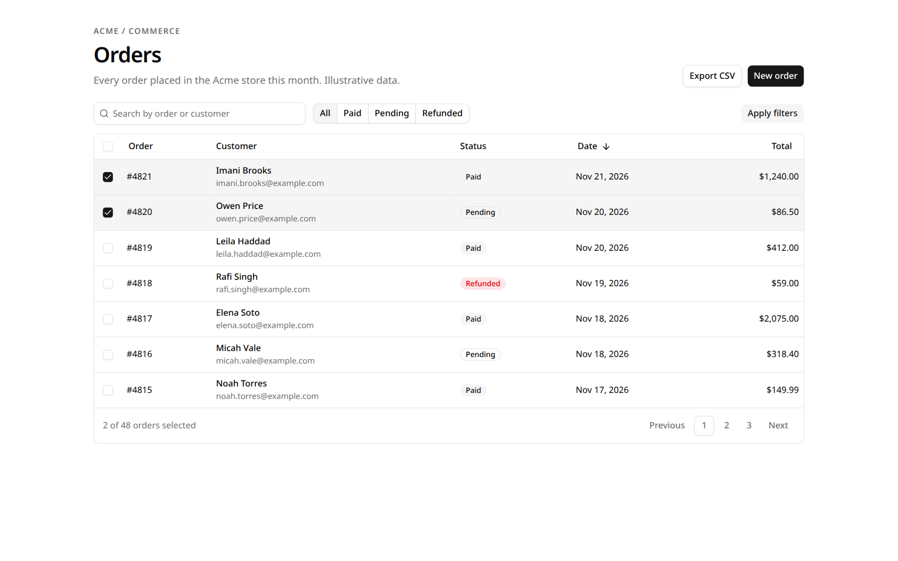

# Orders Data Table — data-table-01

A server-driven data table with search, a status toggle group, row selection, sortable headers, and pagination.

<picture><source media="(prefers-color-scheme: dark)" srcset="./preview-dark.png"></picture>

**Basecoat components:** Table, Input Group, Toggle Group, Button Group, Checkbox, Badge, Button.

**Use:** Copy [`block.html`](./block.html) into a page that loads Tailwind CSS 4 and Basecoat 1.2.1. No JavaScript is required. Filters submit as GET parameters and sort headers and pagination are plain links, so your server renders each state and URLs stay shareable. Mark the sorted column with `aria-sort`. For browser-side sorting, see the Basecoat Data Table recipe with simple-datatables.

**Design rationale:** Selected rows get a muted background and a count in the footer. Numbers are right-aligned in tabular figures so totals line up.
