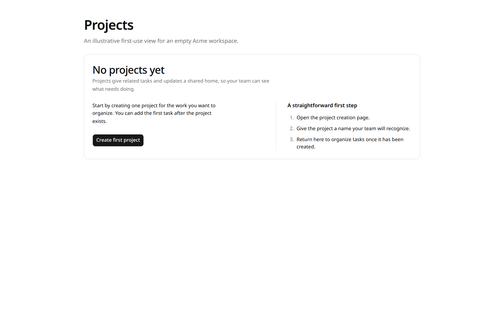

# Project Empty State — empty-state-01

A practical first-use state for an illustrative Acme workspace with no projects: it explains what a project is for, offers a single next step, and shows the simple path from creation to organizing tasks.

<picture><source media="(prefers-color-scheme: dark)" srcset="./preview-dark.png"></picture>

## Basecoat components

Card, Button (link).

## Usage and integration

Copy [`block.html`](./block.html) into your project-list page and load Tailwind CSS 4 and Basecoat 1.2.1. No JavaScript is required.

Replace the example CTA URL `/replace-with-your-project-creation-route` with your real project creation page. This is a navigation link, not an inert button or an implemented creation flow; the standalone preview has **no project backend**, so the example route will not create anything. Render this state only when the current workspace has no projects, and render your actual project list once a project exists. Connect the creation page to your own authenticated create flow and its return path. Adjust the suggested steps if your app's real creation process differs.

## Design rationale

The primary action stays close to the explanation of what and why; the secondary column answers what happens next without competing for attention. The link uses Basecoat button styling but retains native navigation semantics. There is no decorative illustration or implied empty-state functionality.
