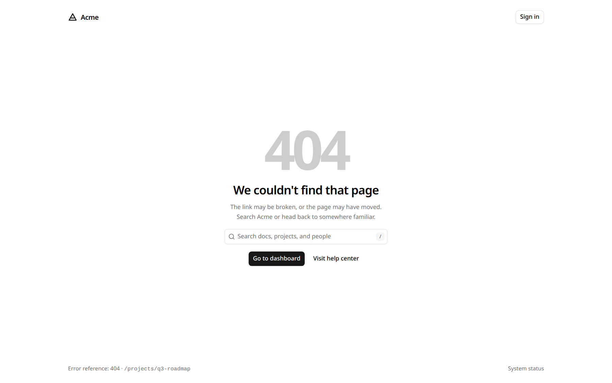

# Not Found Page — error-404-01

A 404 page with search, recovery links, and an error reference for support.

<picture><source media="(prefers-color-scheme: dark)" srcset="./preview-dark.png"></picture>

**Basecoat components:** Empty, Input Group, Kbd, Button.

**Use:** Copy [`block.html`](./block.html) into a page that loads Tailwind CSS 4 and Basecoat 1.2.1. No JavaScript is required. Serve it with a real 404 status. Fill in the requested path on the server and point search at your search route. The `/` shortcut hint needs your own key handler.

**Design rationale:** The oversized, faded 404 marks the page as an error without alarming anyone. Search comes before the links, because most people know what they were looking for.
