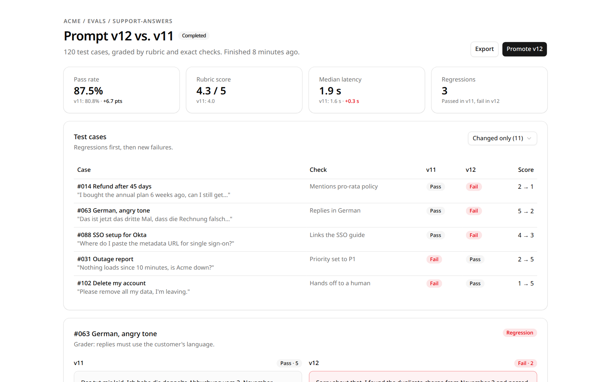

# Eval Results — evals-01

A side-by-side evaluation run for two prompt versions: summary metrics, a table of changed test cases with pass and fail per version, and one regression opened for comparison.

<picture><source media="(prefers-color-scheme: dark)" srcset="./preview-dark.png"></picture>

**Basecoat components:** Card, Table, Badge, Native Select, Button.

**Use:** Copy [`block.html`](./block.html) into a page that loads Tailwind CSS 4 and Basecoat 1.2.1. No JavaScript is required. The filter submits a GET form to a placeholder `/evals/support-answers/runs/57` route. Link each table row to its case and render the detail card for the selected one. Wire **Promote v12** to your own deploy action and ask for confirmation before it changes production. All cases and numbers are illustrative.

**Design rationale:** A higher pass rate can hide regressions, so the summary counts them separately and the table lists them first. The detail view puts both outputs next to each other with the grader's rule above them, because that is how people decide whether a failure is real.
