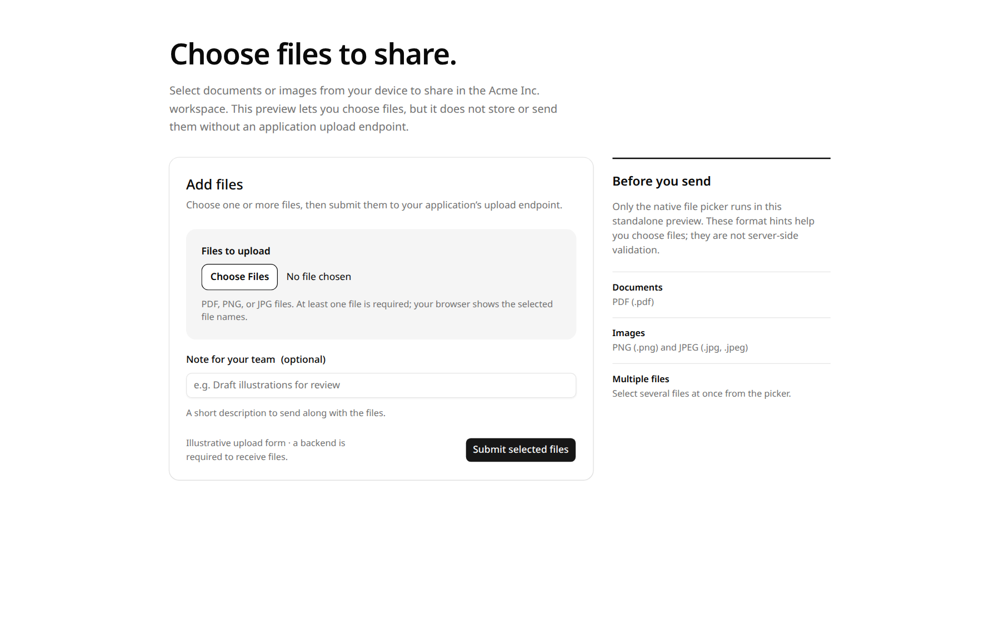

# File Upload — file-upload-01

A native file-selection form for illustrative workspace documents and images. Visitors can choose one or more files and add an optional note; the standalone preview has no receiving backend, upload state, or file library.

<picture><source media="(prefers-color-scheme: dark)" srcset="./preview-dark.png"></picture>

## Basecoat components

Card, Field, Input, Button. The file picker remains a native `<input type="file">` styled with Tailwind `file:` utilities.

## Usage and integration

Copy the full contents of [`block.html`](./block.html) into your page and load Tailwind CSS 4 and Basecoat 1.2.1. No JavaScript or drag-and-drop library is required; the browser handles file selection and required-field validation.

The form submits `files` (one or more file parts) and the optional `note` by `POST` with `enctype="multipart/form-data"` to illustrative `action="/api/files"`. Replace this route with an actual upload handler before use. Handle authentication, CSRF, file counts and sizes, allowed MIME types and extensions, errors, and successful response/navigation in your application. The `accept` attribute filters the picker where supported but is **not** a security boundary; the server must validate files. No file is stored by this static preview, and no progress, success, or drag-and-drop behavior is implied.

## Design rationale

The native picker remains visible instead of hiding file selection behind a decorative drop zone, so choosing files and keyboard access work without JavaScript. Format guidance sits alongside the form on larger screens and follows it on mobile. The single submit button accurately describes the browser action; copy near the form distinguishes selecting files from an upload completed by a backend.
