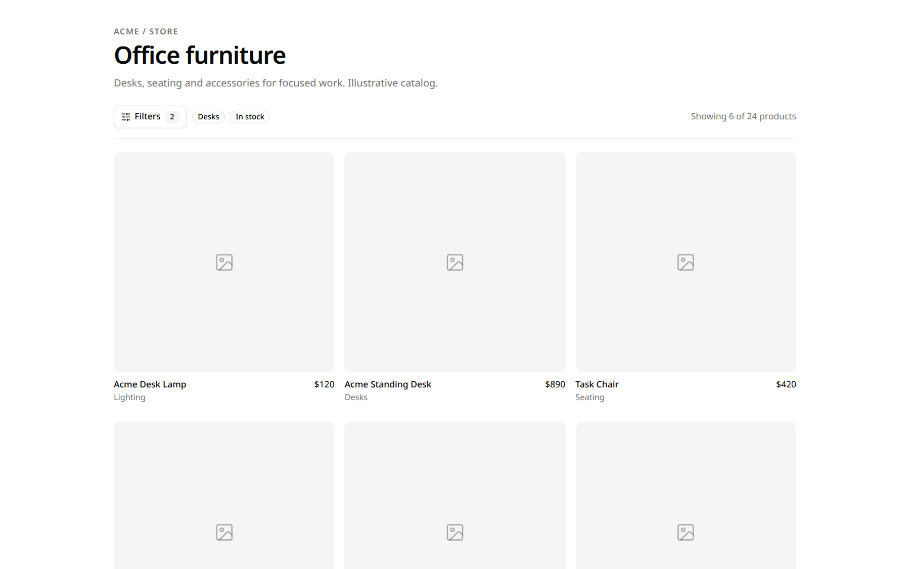

# Product Filters Drawer — filters-01

A product grid whose filters open in a bottom drawer: category checkboxes, a price slider, sort options and an in-stock switch, with the active filters shown as badges above the grid.

<picture><source media="(prefers-color-scheme: dark)" srcset="./preview-dark.png"></picture>

**Basecoat components:** Drawer, Checkbox, Radio Group, Range, Switch, Field, Badge, Button.

**Use:** Copy [`block.html`](./block.html) into a page that loads Tailwind CSS 4, Basecoat 1.2.1 and Basecoat JavaScript (`all.min.js`), which animates the drawer, closes it on a backdrop tap and fills the slider track. The drawer is a native `<dialog>` opened with `showModal()`; Escape closes it. Its form submits `category` (repeated), `max_price`, `sort` and `in_stock` as GET parameters to `/products`, so your server renders the filtered grid and the URL stays shareable. Render the active-filter badges, the count on the Filters button and the "Showing … of …" line from the same query. The one-line `oninput` only mirrors the slider value in its `<output>`. Product tiles use a neutral placeholder; swap in your own images.

**Design rationale:** A bottom drawer keeps every filter within thumb reach on phones and leaves the grid in view behind it. Choices apply only on **Show results**, so the list does not jump on every tap. Active filters stay visible as badges, so nobody forgets the list is narrowed.
