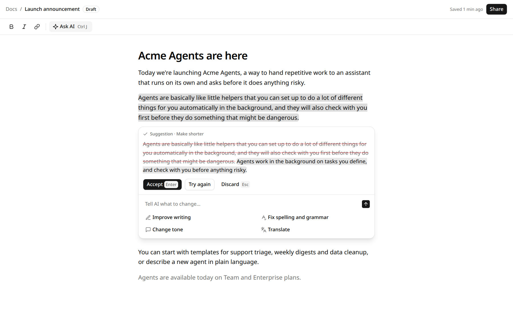

# Inline AI Editing — inline-ai-01

A document editor with an inline AI panel: selected text, a suggested rewrite shown as a deletion and an insertion, accept, retry and discard actions, a free-text instruction and quick actions.

<picture><source media="(prefers-color-scheme: dark)" srcset="./preview-dark.png"></picture>

**Basecoat components:** Input Group, Kbd, Badge, Button.

**Use:** Copy [`block.html`](./block.html) into a page that loads Tailwind CSS 4 and Basecoat 1.2.1. No JavaScript is required to render it. In your editor, wrap the selection in `<mark>` and insert the panel right after the selected block. You could also anchor it to the selection with Basecoat's popover. The instruction and quick actions post `instruction` or `action` to a placeholder `/docs/launch/ai-edit` route. Render the result as `<del>` and `<ins>`, and on **Accept** replace the selection with the inserted text. Bind <kbd>Ctrl</kbd>+<kbd>J</kbd>, <kbd>Enter</kbd> and <kbd>Esc</kbd> in your own script. Nothing is sent from the preview.

**Design rationale:** The suggestion appears as a diff in place, so the writer compares the old and new text without leaving the paragraph. Keyboard hints on Accept and Discard make the common path two keystrokes. Quick actions sit below the input, so a custom instruction is always one click away.
