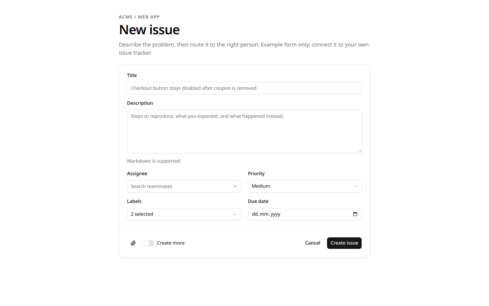

# New Issue Form — issue-form-01

An issue composer with a searchable assignee picker, a priority select, a label popover, a due date, and a file attachment button.

<picture><source media="(prefers-color-scheme: dark)" srcset="./preview-dark.png"></picture>

**Basecoat components:** Card, Field, Input, Textarea, Combobox, Select, Popover, Checkbox, Switch, Tooltip, Button.

**Use:** Copy [`block.html`](./block.html) into a page that loads Tailwind CSS 4, Basecoat 1.2.1 and Basecoat JavaScript (`all.min.js`), which powers the combobox, the select and the popover. The form posts `title`, `description`, `assignee`, `priority`, repeated `labels`, `due_date`, `attachments` and `create_more` to `/replace-with-your-issues-route`; replace it with your own endpoint, add your CSRF field, and set `enctype="multipart/form-data"` if you accept the attachments. Render the assignee options from your team on the server; with many people, filter them with a server request instead. Combobox and select write their value to the hidden inputs inside them. The card has `overflow-visible` so the open pickers are not clipped at its edge. The one-line `onchange` on the label fieldset only updates the "2 selected" summary and can be dropped.

**Design rationale:** Title and description come first because they matter most; the routing fields sit in a two-column grid that stacks on phones. Labels live in a popover so a long label list does not push the submit button off screen. The attachment button is icon-only, so it carries both an `aria-label` and a tooltip.
