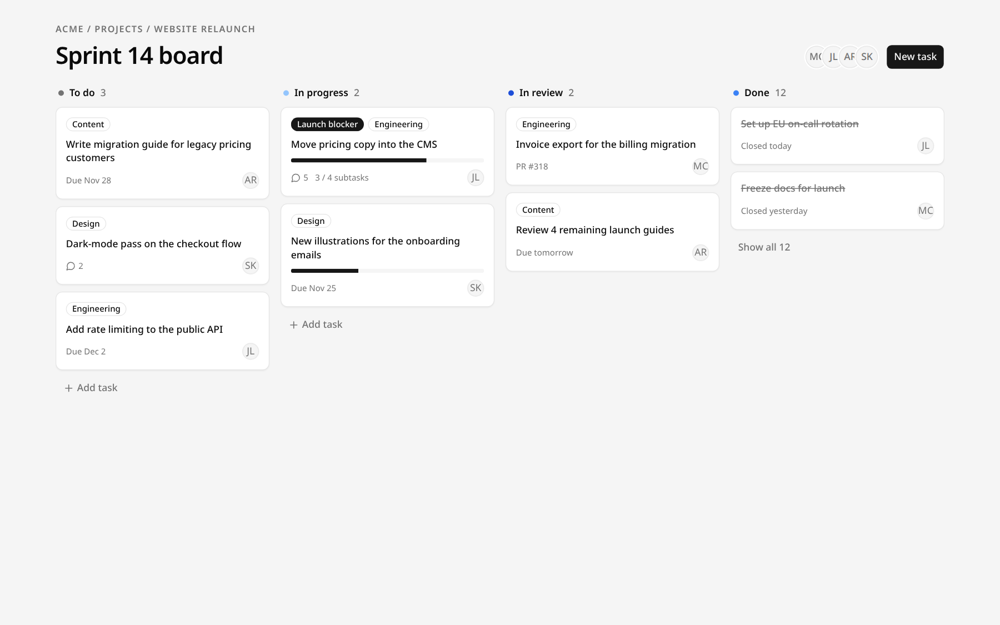

# Kanban Board — kanban-01

A sprint board with status columns, task cards, tags, progress, assignees, and quick-add links.

<picture><source media="(prefers-color-scheme: dark)" srcset="./preview-dark.png"></picture>

**Basecoat components:** Badge, Avatar, Avatar Group, Progress, Button.

**Use:** Copy [`block.html`](./block.html) into a page that loads Tailwind CSS 4 and Basecoat 1.2.1. No JavaScript is required. Columns are an ordered list and cards are list items with real links, so the board works without drag and drop. Add drag and drop with your own script, and keep a keyboard way to move cards (for example a status select on the task page).

**Design rationale:** Status dots use the chart tokens so themes recolor them. Done cards are struck through and muted but stay readable.
