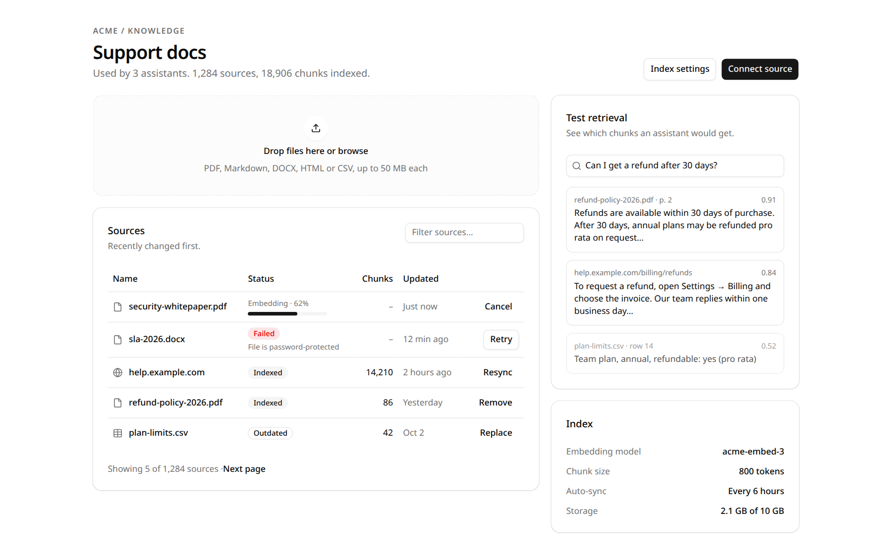

# Knowledge Base — knowledge-base-01

A source manager for retrieval-augmented assistants: drop-zone upload, a table of sources with indexing, failed and outdated states, and a panel that shows which chunks a test question retrieves.

<picture><source media="(prefers-color-scheme: dark)" srcset="./preview-dark.png"></picture>

**Basecoat components:** Card, Table, Progress, Badge, Input, Input Group, Button.

**Use:** Copy [`block.html`](./block.html) into a page that loads Tailwind CSS 4 and Basecoat 1.2.1. No JavaScript is required. The drop zone is a `<label>` around a visually hidden file input, so click and keyboard both open the file picker. It posts to a placeholder `/knowledge/support-docs/files` route, and you add drag-and-drop with your own script. Refresh indexing rows by polling or server-sent events and replace the progress bar with a badge when they finish. The test panel posts the question to `/knowledge/support-docs/query`; render the matches with their similarity score. All data is illustrative.

**Design rationale:** Failed rows say why they failed and offer the one action that fixes them. The retrieval test answers the question everyone asks when an assistant gets something wrong: "what did it actually read?" Weak matches are dimmed, so the cut-off is visible.
