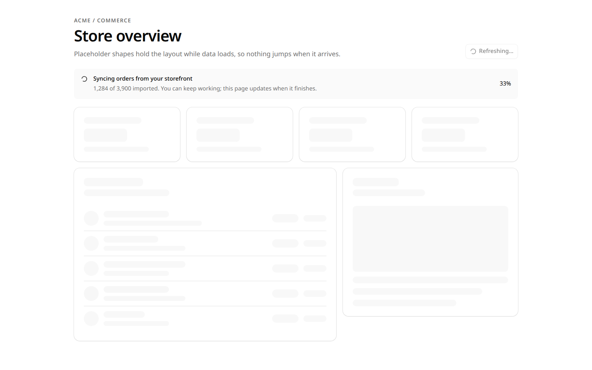

# Loading Skeletons — loading-01

A dashboard in its loading state: skeleton cards, list rows and a panel that mirror the real layout, a background sync status with a spinner, and a disabled button that shows work in progress.

<picture><source media="(prefers-color-scheme: dark)" srcset="./preview-dark.png"></picture>

**Basecoat components:** Skeleton, Spinner, Item, Card, Button.

**Use:** Copy [`block.html`](./block.html) into a page that loads Tailwind CSS 4 and Basecoat 1.2.1. No JavaScript is required. Render it as the placeholder for the region that is loading, then swap in the real content: replace it with server-rendered HTML, or let htmx or your framework swap the region when the request finishes. Size each skeleton like the content it stands in for, so the page does not shift. The skeleton region carries `aria-busy="true"` and a screen-reader note while its shapes are hidden from assistive tech; remove `aria-busy` when content arrives. The sync status uses a spinner with `role="status"` inside an `aria-live` item; update its numbers from your job status.

**Design rationale:** Skeletons copy the shape of the finished dashboard instead of showing one central spinner, so the wait feels shorter and nothing jumps. A spinner is reserved for a process the user started or should know about. The busy button stays in place with a short verb, so the user can see their click registered.
