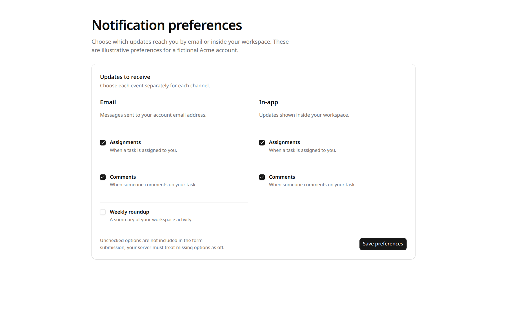

# Notification Preferences — notifications-01

An illustrative Acme account form for choosing notification events separately across email and in-app channels. The initial checked states are example values, not saved account data.

<picture><source media="(prefers-color-scheme: dark)" srcset="./preview-dark.png"></picture>

## Basecoat components

Card, Fieldset, Field, Checkbox, Button.

## Usage and integration

Copy [`block.html`](./block.html) into your page and load Tailwind CSS 4 and Basecoat 1.2.1. No JavaScript is needed for the native checkboxes or form submission.

Replace `/replace-with-your-notification-preferences-endpoint` with your POST route, supply CSRF protection and account authentication, and render the initial `checked` attributes from persisted preferences. The static preview does **not** save anything: its example action has no backend.

The form submits `email_assignment`, `email_comment`, `email_weekly_roundup`, `in_app_assignment`, and `in_app_comment`, each with value `on` **only when checked**. Unchecked boxes are omitted by the browser. On the server, evaluate this entire allowlist for each save: a present name means enabled, an absent name means disabled. Do not merge only present values into the prior settings, or users will be unable to turn an option off. Validate the names, persist for the authenticated account, and render a confirmation or validation error in your application. If adding other events or channels, update both the rendered controls and the server allowlist.

## Design rationale

Native fieldsets name the channels, and each event has its own labeled checkbox and description. Repeated event labels remain understandable because the group legend supplies the channel. A single save action applies to the full preference set; an explicit note explains the native unchecked-checkbox submission behavior before integration.
