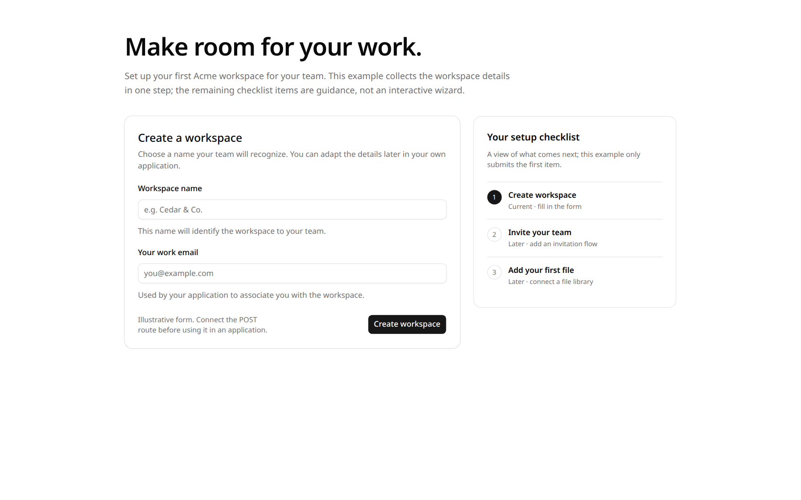

# Workspace Setup — onboarding-01

A first-run workspace creation screen with a visible setup checklist and a real native form for the current task. The workspace, organization, and email references are illustrative; the checklist is informational, not a multi-step wizard.

<picture><source media="(prefers-color-scheme: dark)" srcset="./preview-dark.png"></picture>

## Basecoat components

Card, Field, Input, Button.

## Usage and integration

Copy the full contents of [`block.html`](./block.html) into your page and load Tailwind CSS 4 and Basecoat 1.2.1. No JavaScript is needed.

The form uses native required text/email validation and submits `workspace_name` and `owner_email` with `method="post"` to illustrative `action="/api/workspaces"`. Replace that route with your application’s workspace-creation handler, add any authentication and CSRF handling it requires, and handle success/errors on the server. The static preview has no backend and creates nothing. Replace the checklist guidance with real next-step destinations or state only after implementing those flows; items two and three have no controls and never advance automatically.

## Design rationale

The form takes the primary column so the immediate action is unmistakable. A quieter checklist puts the work in context without presenting unavailable steps as interactive; the first row explicitly identifies the current task. Visible field labels, unique IDs, native validation, and a single submit action make the fragment usable independently of any wizard runtime.
