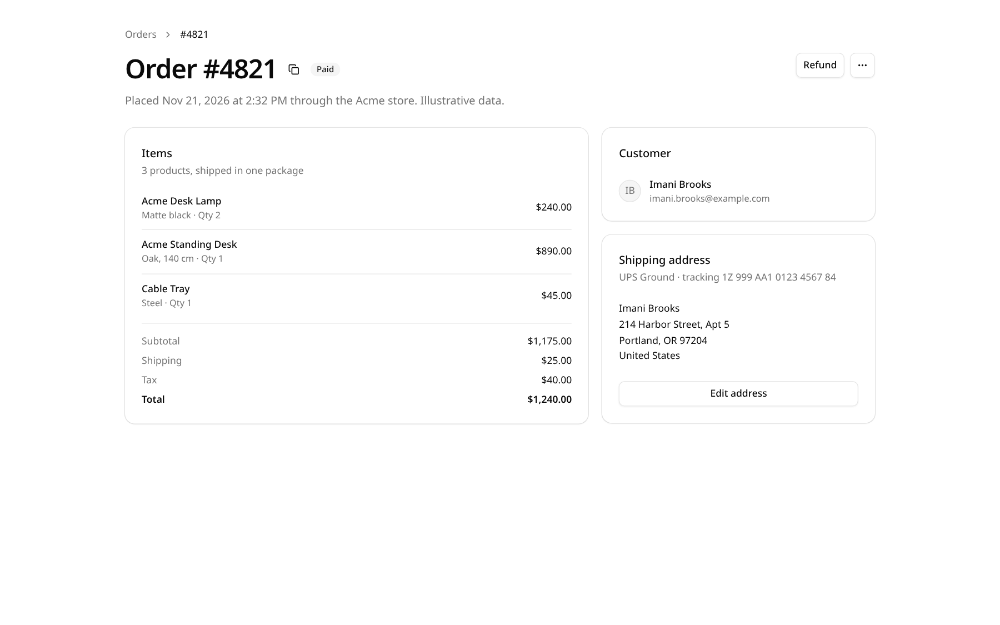

# Order Detail — order-detail-01

A single-order page with a breadcrumb, line items and totals, customer and shipping cards, a copy-to-clipboard ID with a toast, a refund confirmation, an actions menu, and a side sheet for editing the address.

<picture><source media="(prefers-color-scheme: dark)" srcset="./preview-dark.png"></picture>

**Basecoat components:** Breadcrumb, Card, Badge, Avatar, Button, Tooltip, Toast, Dropdown Menu, Alert Dialog, Sheet, Field, Input, Native Select.

**Use:** Copy [`block.html`](./block.html) into a page that loads Tailwind CSS 4, Basecoat 1.2.1 and Basecoat JavaScript (`all.min.js`), which runs the actions menu, the sheet animation and the toaster. The refund confirmation and the sheet are native `<dialog>` elements opened with `showModal()`. Three placeholder routes need your own endpoints, CSRF fields and authorization: `/replace-with-your-refund-route` and `/replace-with-your-receipt-route` take `order_id`; `/replace-with-your-shipping-address-route` takes `order_id`, `name`, `line1`, `city`, `postal_code` and `country`. After a successful POST, redirect back and render a toast server-side by appending `.toast` markup to `#toaster`. The copy button is real client-side behavior: it writes the ID with the Clipboard API (which needs HTTPS or localhost) and confirms with `toaster.toast()`. Keep one `#toaster` per page.

**Design rationale:** The page leads with the order number and status, so the most-asked questions are answered above the fold. The refund is a visible button, but it always asks first and names the exact amount. Rarer actions live in a menu; an action that no longer applies stays visible but disabled, with the reason beside it. The address is edited in a side sheet so the order stays in view behind it.
