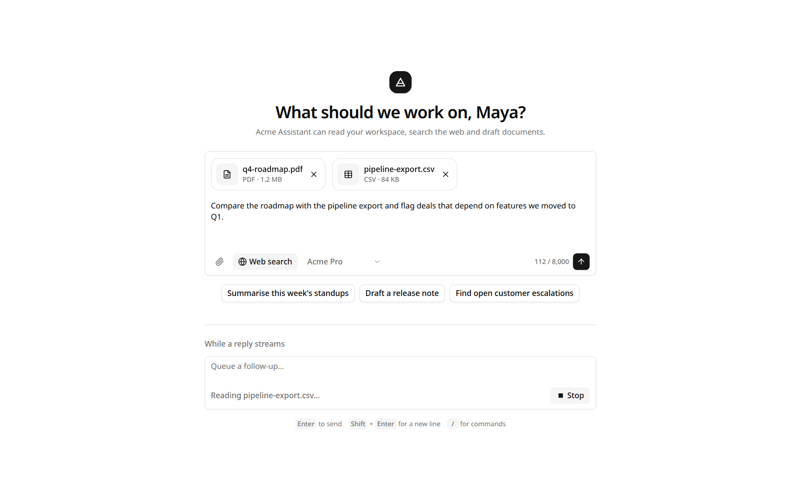

# Prompt Composer — prompt-input-01

A new-conversation screen with a full prompt composer: attached files, a web search toggle, a model picker, a character count, suggested prompts, and a streaming state with a stop button.

<picture><source media="(prefers-color-scheme: dark)" srcset="./preview-dark.png"></picture>

**Basecoat components:** Input Group, Textarea, Attachment, Native Select, Button, Shimmer, Kbd.

**Use:** Copy [`block.html`](./block.html) into a page that loads Tailwind CSS 4 and Basecoat 1.2.1. No JavaScript is required. The form posts `message` and `model` to a placeholder `/assistant/conversations` route. Wire the attach button to a hidden `<input type="file">`, render one `.attachment` per uploaded file, and flip `aria-pressed` on the web search toggle in your own script. Show the second composer while a reply streams, and make **Stop** cancel the request. Nothing is sent from the preview.

**Design rationale:** Attachments sit inside the composer, so it is obvious what the model will see. Model choice and tools stay small and to the side, because most people never change them. The keyboard hints are written out instead of shown as tooltips, so new users find them.
