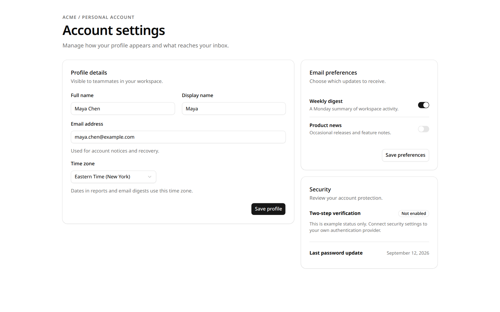

# Account Settings — settings-01

A personal account page with editable profile fields, email preferences, and a read-only security summary.

<picture><source media="(prefers-color-scheme: dark)" srcset="./preview-dark.png"></picture>

## Basecoat components

Card, Field, Input, Native Select, Switch, Button, Badge.

## Usage

Copy the full contents of [`block.html`](./block.html) into a page with Tailwind CSS 4 and Basecoat 1.2.1. No JavaScript is required for the native inputs or switches.

**Integration examples, not working account updates:** both forms use clearly named placeholder `action` URLs. Replace those URLs with real POST routes, implement server-side validation and CSRF protection, populate initial values from the signed-in account, and persist checkbox states. The security panel is example status only; connect it to your authentication provider rather than presenting it as live security information.

## Design rationale

The wider profile column keeps identity fields easy to scan while the narrow column isolates optional notifications and security context. Native labels and descriptions linked to the switches with `aria-describedby` preserve their context for assistive technology. The columns collapse to a single flow on smaller screens.
