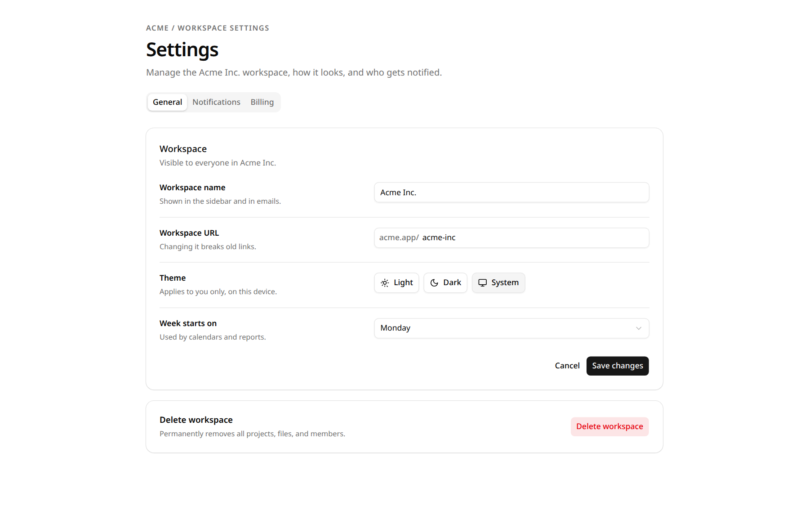

# Tabbed Workspace Settings — settings-02

Workspace settings in tabs, with label-and-control rows, a theme toggle group, and a danger zone.

<picture><source media="(prefers-color-scheme: dark)" srcset="./preview-dark.png"></picture>

**Basecoat components:** Tabs, Card, Field, Input Group, Toggle Group, Native Select, Switch, Button.

**Use:** Copy [`block.html`](./block.html) into a page that loads Tailwind CSS 4 and Basecoat 1.2.1. It needs Basecoat JavaScript: load Basecoat's `all.min.js` once in your page. Tabs need `tabs.js` (in `all.min.js`). Each panel holds its own form with a placeholder action; add CSRF protection and server validation. The theme radios submit a value; apply it in your app.

**Design rationale:** Two-column rows keep the explanation next to each control. The destructive action is set apart with a tinted border instead of louder colors elsewhere.
