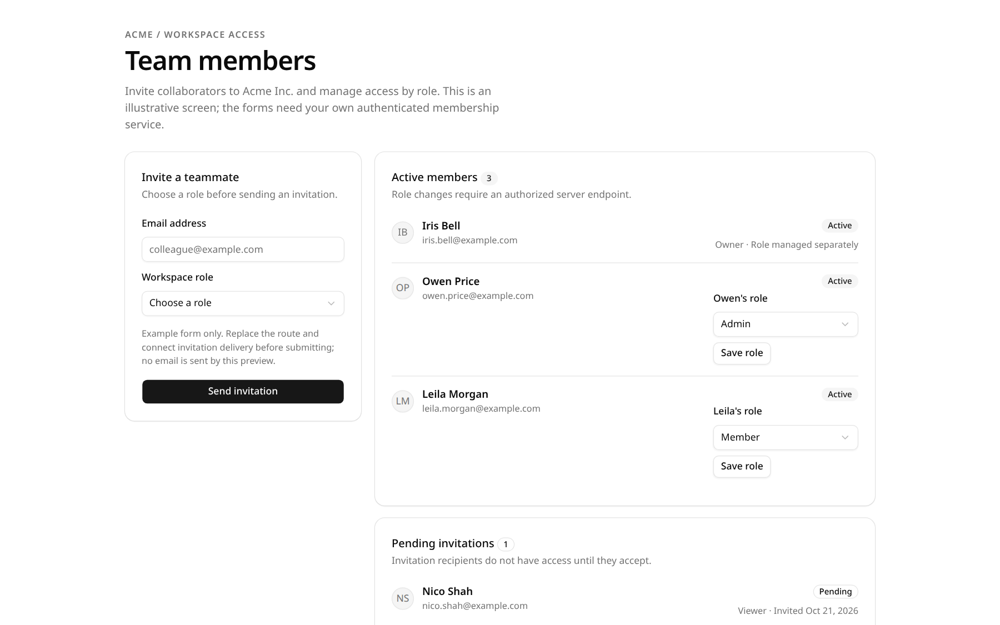

# Team Members — team-members-01

An invitation and role-management workspace screen. A labeled email-and-role form, editable active memberships, a protected owner display, and a separate pending-invitations section make access changes explicit. All people, email addresses, roles, counts, and dates are illustrative static examples; no invitation is sent and no role is changed by this preview.

<picture><source media="(prefers-color-scheme: dark)" srcset="./preview-dark.png"></picture>

## Basecoat components

Card, Field, Input, Native Select, Button, Badge, Avatar.

## Usage and integration

Copy the full contents of [`block.html`](./block.html) into a page using Tailwind CSS 4 and Basecoat 1.2.1. There is no client-side JavaScript. **Do not submit the static preview forms**; their POST actions are deliberately nonfunctional placeholders:

- `/replace-with-your-team-invite-route` accepts `email` and `role`. Replace it with an authenticated invitation endpoint that verifies role permissions, validates the address, delivers the invite, and updates pending membership state.
- `/replace-with-your-team-role-route` accepts `membership_id` and `role`. Replace it with an authenticated role-change endpoint that verifies the target belongs to the current workspace and the actor can grant that role. Render current roles from the server after a successful response; changing a native select in the preview does not save anything.

Supply real membership identifiers, statuses, and dates, plus your application’s CSRF fields in every POST form. Authorize these operations on the server and prevent last-owner removal or role downgrade there. The owner is deliberately not editable in this example. Pending invitations are shown separately from active members and have no resend or cancel behavior implied; connect such flows separately if needed.

## Design rationale

The invite form leads the workflow rather than merely repeating a read-only directory. Active roles are adjustable with native selects and explicit Save buttons; a status badge and locked owner cue distinguish access state from form state. Pending invites occupy their own card so they cannot be mistaken for active access, while small-screen layouts stack controls and retain visible labels.
