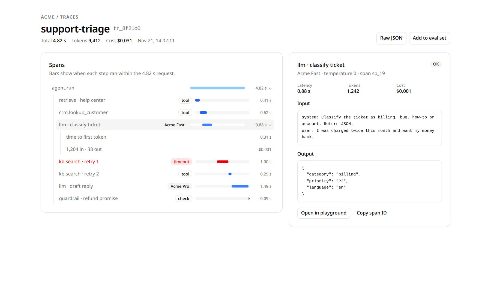

# LLM Trace — trace-01

An observability view for one agent request: nested spans for model calls, tools and guardrails with a timing waterfall, a failed retry, and the selected span's input, output, tokens and cost.

<picture><source media="(prefers-color-scheme: dark)" srcset="./preview-dark.png"></picture>

**Basecoat components:** Trace, Card, Code Block, Badge, Button.

**Use:** Copy [`block.html`](./block.html) into a page that loads Tailwind CSS 4 and Basecoat 1.2.1. No JavaScript is required: span groups open and close with native `
`. For each bar, set the start offset (`ms-[…]`) to start ÷ total and the width to duration ÷ total. If you generate the offset at runtime, use an inline `margin-inline-start` instead of an arbitrary Tailwind class. Make each span a link or button that loads its details into the side card. Bars and badges hide on narrow screens, so durations stay readable. All data is illustrative.

**Design rationale:** The waterfall shows where the time went at a glance: here, a search timeout and its retry. Failures are red in both the label and the bar. The detail card stays in view while you scroll, and offers "Add to eval set", so a bad trace can become a test case.
