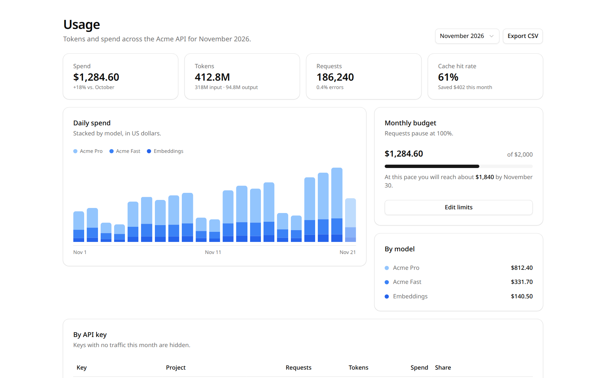

# AI Usage — usage-01

A token and spend dashboard for an AI API: monthly totals, daily spend stacked by model, a budget meter with a forecast, and a breakdown per API key.

<picture><source media="(prefers-color-scheme: dark)" srcset="./preview-dark.png"></picture>

**Basecoat components:** Card, Native Select, Progress, Table, Button.

**Use:** Copy [`block.html`](./block.html) into a page that loads Tailwind CSS 4 and Basecoat 1.2.1. No JavaScript is required. The period picker submits a GET form to a placeholder `/usage` route, and **Export CSV** links to `/usage/export.csv`. The bar chart is plain HTML: render each day's height as a percentage of the busiest day, and each segment as that model's share of the day. Keep the `aria-label` on every bar so screen readers get the numbers. For hover tooltips or zoom, swap in Basecoat's Chart helper. All figures are illustrative.

**Design rationale:** Spend comes first because that is what people check. Cache savings get their own tile, since they explain why spend and tokens do not move together. The forecast sits under the budget meter, so a team sees a problem before requests pause.
