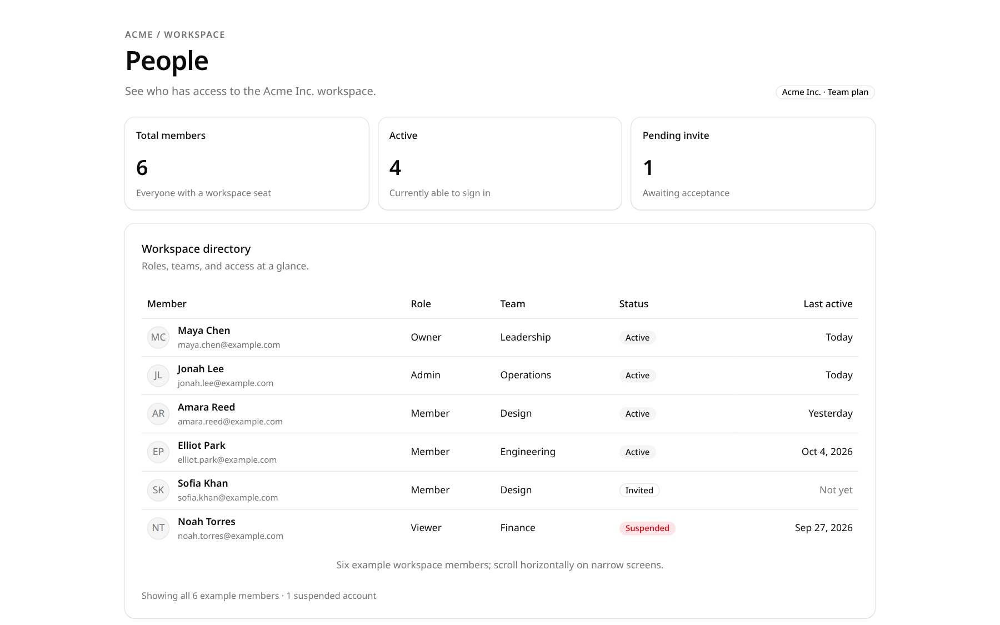

# Users Table — users-01

A workspace directory with member identity, role, team, access status, and last activity. The six records and summary counts are illustrative static example data.

<picture><source media="(prefers-color-scheme: dark)" srcset="./preview-dark.png"></picture>

## Basecoat components

Card, Table, Avatar, Badge.

## Usage

Copy the full contents of [`block.html`](./block.html) and load Tailwind CSS 4 and Basecoat 1.2.1. No JavaScript is needed. Replace the example rows, status labels, last-activity timestamps, and summary counts with actual workspace data. The table is a read-only directory: sorting, invitations, role changes, filtering, and pagination are **not** implemented or implied.

## Design rationale

Compact membership totals establish context before the full directory. Names and addresses share a single identity column, leaving space for access and activity signals. Status is conveyed by both text and badge styling; native table headings and a caption preserve meaning when the table scrolls horizontally on small screens.
