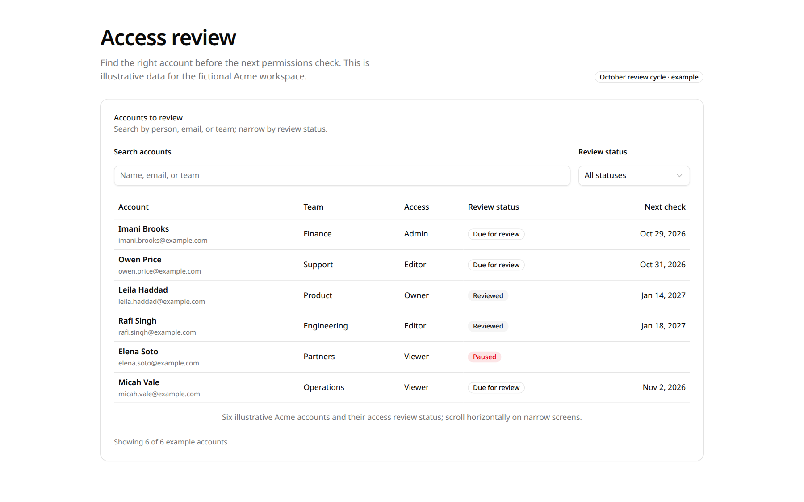

# Access Review Table — users-table-02

A filterable operational view of account access reviews. All six fictional Acme accounts, statuses, roles, teams, and dates are illustrative; this block does not connect to an access-control system.

<picture><source media="(prefers-color-scheme: dark)" srcset="./preview-dark.png"></picture>

## Basecoat components

Card, Table, Input, Select (native), Badge.

## Usage and integration

Copy the full contents of [`block.html`](./block.html) and load Tailwind CSS 4 and Basecoat 1.2.1. No Basecoat JavaScript is required for these components; the fragment's inline script filters the six rendered rows client-side by text and review status, updates the live result count, and shows a no-match message. Search and status filters combine; the status select is a native control. The table scrolls horizontally on narrow screens.

Replace the illustrative rows and dates with actual records before rendering the page; retain a matching `data-status` value on each row. The script indexes rows once on page load, so dynamic updates need the host application to rebuild its own index. Do not treat the visible review status as an authorization decision: saving reviews, changing permissions, server-side filtering, pagination, and exports are **not implemented**. Give every instance unique IDs if placing multiple copies on one page.

## Design rationale

Unlike the read-only members directory in `users-01`, this table focuses on the next access-review check and provides meaningful, immediate filters. Clearly labeled controls and a live count communicate the current subset; the caption and column headers retain table context when scrolling. There are no inert per-row actions or implied write operations.
