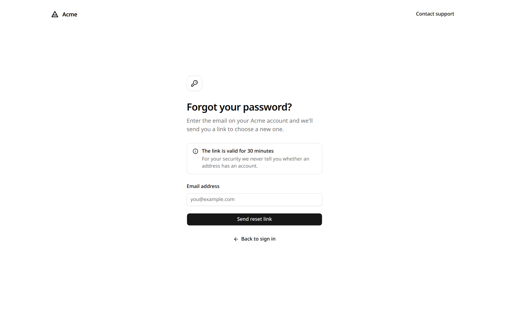

# Forgot Password — forgot-password-01

A password-reset request with a quiet top bar, a security note, and a clear way back to sign in.

<picture><source media="(prefers-color-scheme: dark)" srcset="./preview-dark.png"></picture>

**Basecoat components:** Alert, Field, Input, Button.

**Use:** Copy [`block.html`](./block.html) into a page that loads Tailwind CSS 4 and Basecoat 1.2.1. No JavaScript is required. Replace `POST /password/forgot` with your reset endpoint. Always show the same confirmation whether or not the address exists, and expire reset links on the server.

**Design rationale:** The alert explains the deliberately vague response up front, so a missing email does not look like a bug.
