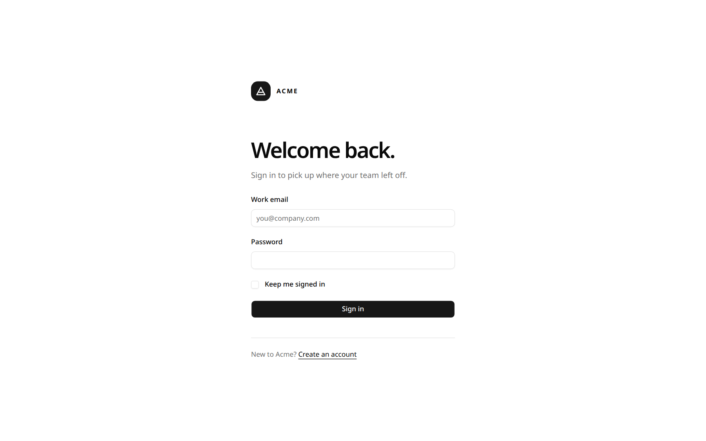

# Simple Login

A quiet, single-column sign-in page for a focused workspace. The brand, form, and secondary path remain readable on small screens.

<picture><source media="(prefers-color-scheme: dark)" srcset="./preview-dark.png"></picture>

**Basecoat components:** Button, Field, Input, Checkbox.

**Use:** Copy [`block.html`](./block.html) into your page and load Tailwind CSS 4 and Basecoat 1.2.1. Connect the `POST /login` form to your authentication endpoint (including your CSRF protection), implement the optional `remember` policy, and replace the example `/signup` link with your signup route. No JavaScript is needed.

**Design rationale:** A deliberately unboxed form keeps the email/password path immediate; a small high-contrast brand mark and a thin footer rule supply hierarchy without decoration competing with the controls.
