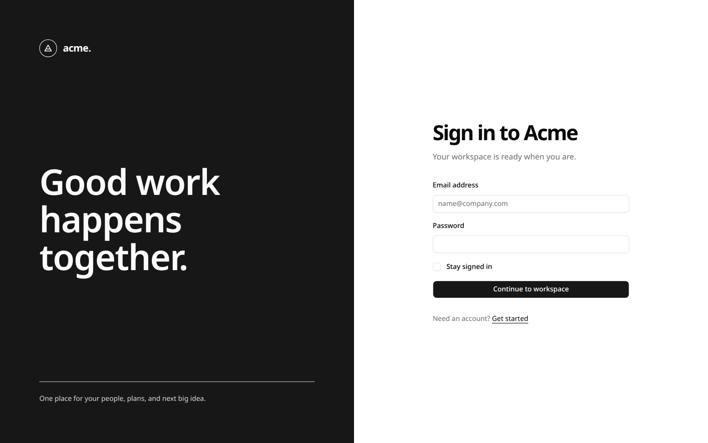

# Split Screen Login

An editorial two-panel sign-in with a dedicated brand story beside the form. The story compresses above the form at narrow widths.

<picture><source media="(prefers-color-scheme: dark)" srcset="./preview-dark.png"></picture>

**Basecoat components:** Button, Field, Input, Checkbox.

**Use:** Copy [`block.html`](./block.html) into a page with Tailwind CSS 4 and Basecoat 1.2.1. Connect `POST /login` to your real sign-in handler with CSRF protection, decide how the optional `remember` field is honored, and replace the example `/signup` link with your signup route. No JavaScript is needed.

**Design rationale:** A large typographic statement gives the brand a memorable voice while the right-hand form stays small, calm, and easy to scan; on mobile the message shortens to preserve access to the form.
