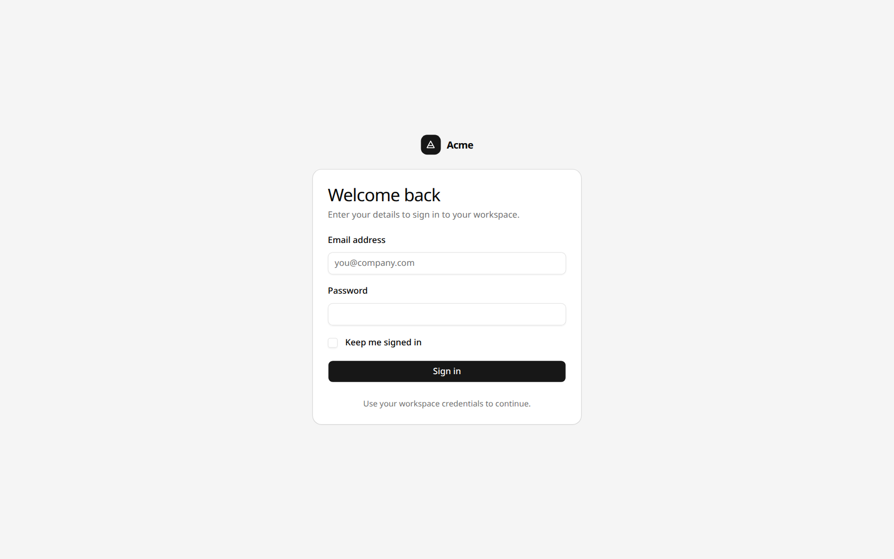

# Card Login — login-03

A compact sign-in inside a Basecoat card on a quiet contrasting surface. Use it where account access is a secondary step, not the whole brand story.

<picture><source media="(prefers-color-scheme: dark)" srcset="./preview-dark.png"></picture>

**Basecoat components:** Card, Field, Input, Checkbox, Button.

**Use:** Copy [`block.html`](./block.html) into a page with Tailwind CSS 4 and Basecoat 1.2.1. No JavaScript is needed. Replace the example `POST /login` action with your authentication endpoint, add CSRF handling, server validation, errors, and your own session policy. The static preview cannot sign anyone in.

**Design rationale:** The narrow, familiar card keeps credentials easy to scan, while the muted background distinguishes this pattern from the unframed simple login and the editorial split login.
