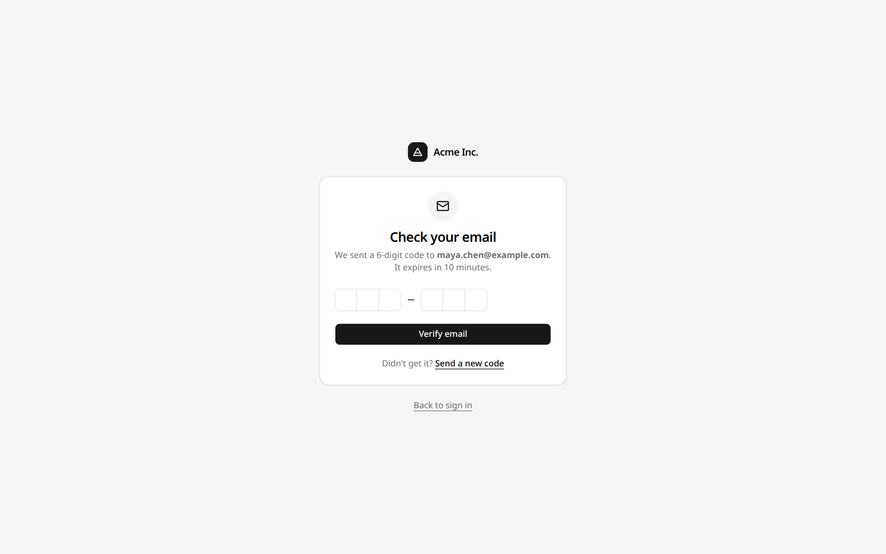

# Email Verification — otp-01

One-time code entry after sign-up or sign-in, built on the 1.2 Input OTP component.

<picture><source media="(prefers-color-scheme: dark)" srcset="./preview-dark.png"></picture>

**Basecoat components:** Card, Field, Input OTP, Button.

**Use:** Copy [`block.html`](./block.html) into a page that loads Tailwind CSS 4 and Basecoat 1.2.1. It needs Basecoat JavaScript: load Basecoat's `all.min.js` once in your page. Replace the `POST /verify` and `/verify/resend` actions with your routes. Input OTP keeps a single native `<input name="code">`, so the form submits normally and works without JavaScript; `data-filter` with `pattern="[0-9]+"` rejects non-digits while typing or pasting. Rate-limit both endpoints on the server.

**Design rationale:** Two groups of three slots read faster than six in a row. The email address is repeated so people notice a typo before waiting for a code that will never arrive.
