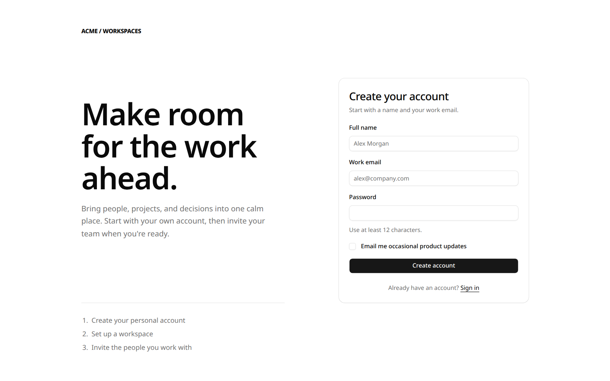

# Signup — signup-01

A responsive account-creation screen pairing a concise setup story with a focused Basecoat form.

<picture><source media="(prefers-color-scheme: dark)" srcset="./preview-dark.png"></picture>

**Basecoat components:** Card, Field, Input, Checkbox, Button.

**Use:** Copy [`block.html`](./block.html) into a page that loads Tailwind CSS 4 and Basecoat 1.2.1. No JavaScript is needed. Connect the example `POST /signup` action to your own account service with CSRF protection, server-side validation, email verification, and secure password handling; honor the optional updates checkbox only with consent. Replace the example `/login` link with your real login route. No account is created by the static preview.

**Design rationale:** The setup sequence conveys what happens after account creation without adding extra form fields. On mobile, the optional step list disappears so the labelled form is reachable sooner.
