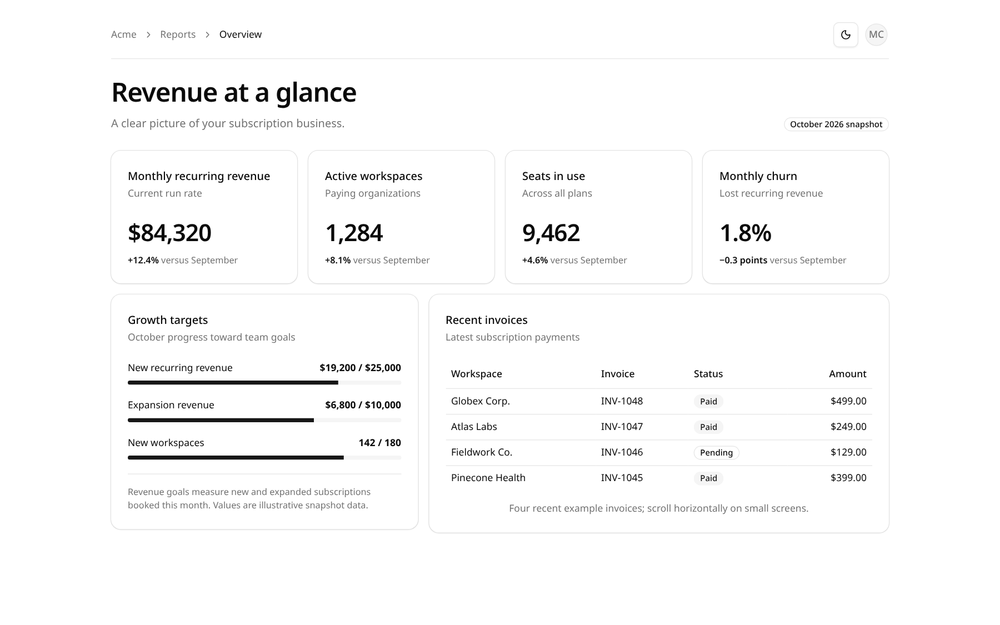

# SaaS Dashboard — dashboard-01

A subscription-business overview with a breadcrumb top bar, theme toggle, account menu, four KPIs, goal progress, and recent invoices. All figures are illustrative static example data.

<picture><source media="(prefers-color-scheme: dark)" srcset="./preview-dark.png"></picture>

## Basecoat components

Breadcrumb, Theme Switcher, Tooltip, Dropdown Menu, Avatar, Card, Badge, Progress, Table.

## Usage

Copy the full contents of [`block.html`](./block.html) into a page with Tailwind CSS 4 and Basecoat 1.2.1. It needs Basecoat JavaScript for the account menu and the theme toggle (`window.basecoat.theme.toggle()` flips `html.dark` and remembers the choice in `localStorage`). Point the breadcrumb and menu links at your own routes; the menu items are plain links, so log out should hit a route that ends the session (use a small `POST` form there if your framework requires it). Replace snapshot figures, progress values, invoice rows, and month labels from your own data. Update both each progress indicator's visual width and its `aria-valuenow` when values change.

## Design rationale

A quiet four-card summary makes the most important business numbers scannable first. Target bars add visual momentum without a chart library, while the invoice table grounds the metrics in recognizable transactions. The top bar keeps navigation context and account actions out of the content. The theme toggle is the only place that uses `dark:` utilities, to swap the sun and moon icons. The table scrolls horizontally on narrow screens rather than hiding columns or clipping data.
