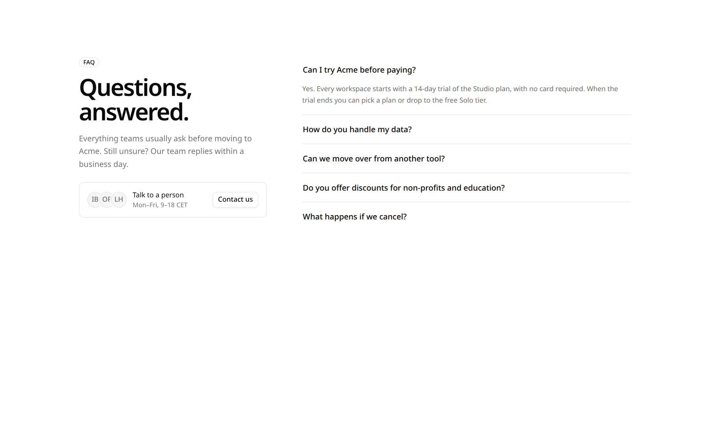

# FAQ Section — faq-01

An FAQ with a sticky intro, a contact card, and an animated accordion.

<picture><source media="(prefers-color-scheme: dark)" srcset="./preview-dark.png"></picture>

**Basecoat components:** Accordion, Avatar Group, Badge, Button.

**Use:** Copy [`block.html`](./block.html) into a page that loads Tailwind CSS 4 and Basecoat 1.2.1. It needs Basecoat JavaScript: load Basecoat's `all.min.js` once in your page. The accordion uses native `
`; `transition-details` animates opening, and `accordion.js` (in `all.min.js`) adds the single-open behavior. Answers stay readable and searchable without JavaScript.

**Design rationale:** The intro column stays visible while you scroll, so the way to contact a person is always one click away.
