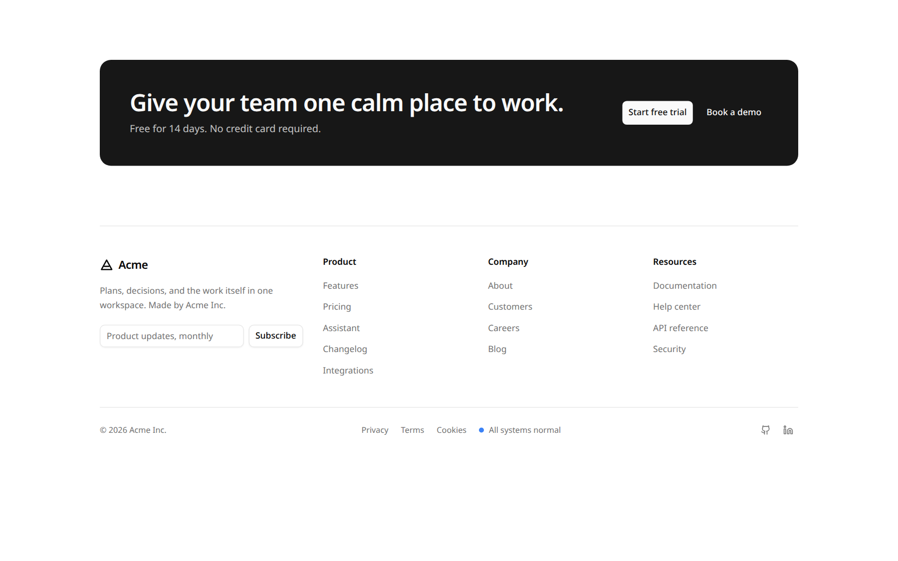

# Footer with CTA — footer-01

A site footer with a call-to-action band, link columns, a newsletter form, status, and social links.

<picture><source media="(prefers-color-scheme: dark)" srcset="./preview-dark.png"></picture>

**Basecoat components:** Input, Button.

**Use:** Copy [`block.html`](./block.html) into a page that loads Tailwind CSS 4 and Basecoat 1.2.1. No JavaScript is required. Point the newsletter form at your provider and replace links and the status URL. The CTA band uses `--primary` and `--primary-foreground`, so it follows your theme.

**Design rationale:** One inverted band gives the page an ending before the link columns. The legal row is kept small but within contrast limits.
