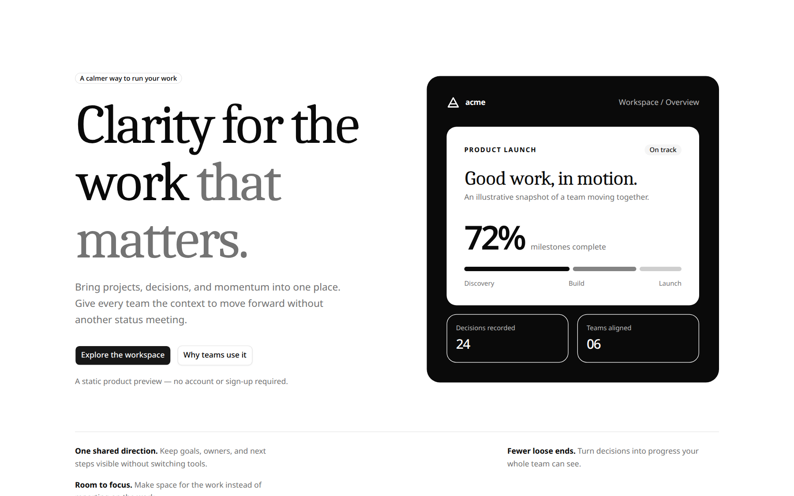

# SaaS Hero — hero-01

A text-first SaaS introduction for an illustrative team workspace, pairing a clear pitch with a product-style snapshot and three supporting benefits. The name, progress, and workspace metrics are fictional example content, not live product data.

<picture><source media="(prefers-color-scheme: dark)" srcset="./preview-dark.png"></picture>

## Basecoat components

Button (navigation links styled as `.btn`), Badge.

## Usage

Copy all of [`block.html`](./block.html) into your page and load Tailwind CSS 4 and Basecoat 1.2.1. No JavaScript, images, fonts, or framework are required. Both links navigate to sections within the fragment: “Explore the workspace” targets the example snapshot, and “Why teams use it” targets the benefits. If you replace either destination with an external page, sign-up flow, or product tour, supply the real route and functionality in your application; none is included here. Replace the Acme name, pitch, illustrations of progress, and metrics with your actual offering and data before publishing.

## Design rationale

The editorial serif headline leads, while the dark product frame acts as a visual proof-of-concept without relying on a stock image or an invented testimonial. A readable progress label and clearly illustrative numbers keep the snapshot honest. Native anchor navigation and a single-column mobile layout keep the actions useful across devices.
