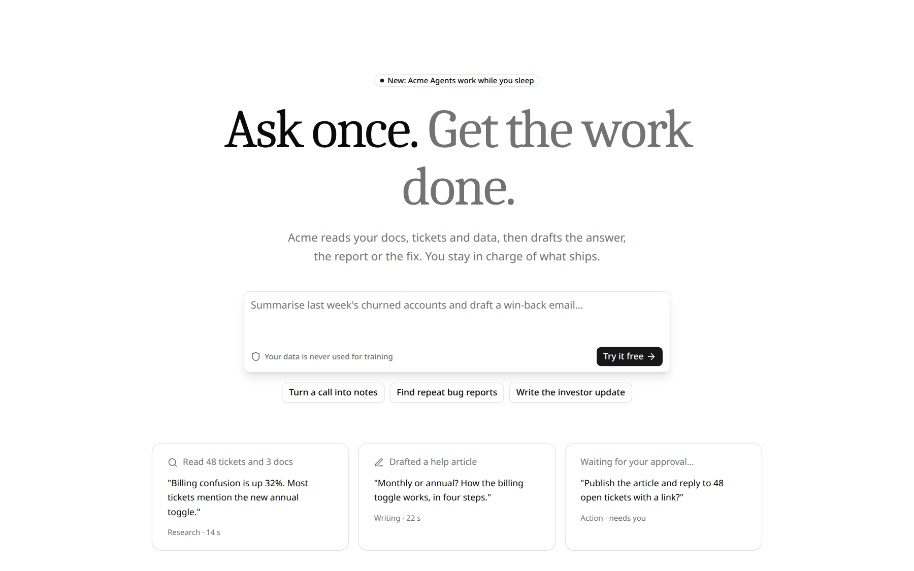

# AI Product Hero — hero-02

A hero for an AI product: an announcement badge, a serif headline, a prompt box as the main call to action, example prompts, and three cards that show the assistant researching, writing and asking for approval.

<picture><source media="(prefers-color-scheme: dark)" srcset="./preview-dark.png"></picture>

**Basecoat components:** Input Group, Textarea, Card, Marker, Shimmer, Badge, Button.

**Use:** Copy [`block.html`](./block.html) into a page that loads Tailwind CSS 4 and Basecoat 1.2.1. No JavaScript is required. The prompt box submits a GET form to a placeholder `/signup` route with the visitor's text as `prompt`, so your app can start with that task after sign-up. Example prompts are plain links with the same parameter. Replace the customer count and the privacy line with claims you can back up. All copy is illustrative.

**Design rationale:** Most AI heroes say "Get started". This one lets visitors type their own task, which explains the product and starts sign-up at once. The three cards show a whole flow, from research to writing to approval, so "you stay in charge" is shown, not just claimed.
