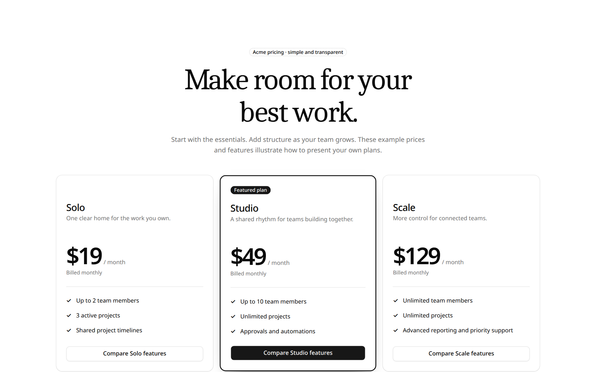

# Pricing Section — pricing-01

A three-tier example pricing section with one featured plan and a detailed, horizontally scrollable comparison table.

<picture><source media="(prefers-color-scheme: dark)" srcset="./preview-dark.png"></picture>

**Basecoat components:** Card, Button (anchor links), Badge, Table.

**Use:** Copy [`block.html`](./block.html) into a page with Tailwind CSS 4 and Basecoat 1.2.1. No JavaScript is needed. Basecoat's `.table-container` supplies horizontal scrolling; a table minimum width keeps comparison columns legible. All prices, plan limits, features, and comparisons are **illustrative**; replace them with your actual offering. The plan links currently jump to their comparison-table columns, not to checkout. Supply a real checkout route, legal terms, and billing logic in your own application if you change these calls to action.

**Design rationale:** The featured middle tier creates a clear comparison point without inventing a 'best for everyone' claim. The table gives factual distinctions a reader can scan, and native links remain keyboard accessible.
