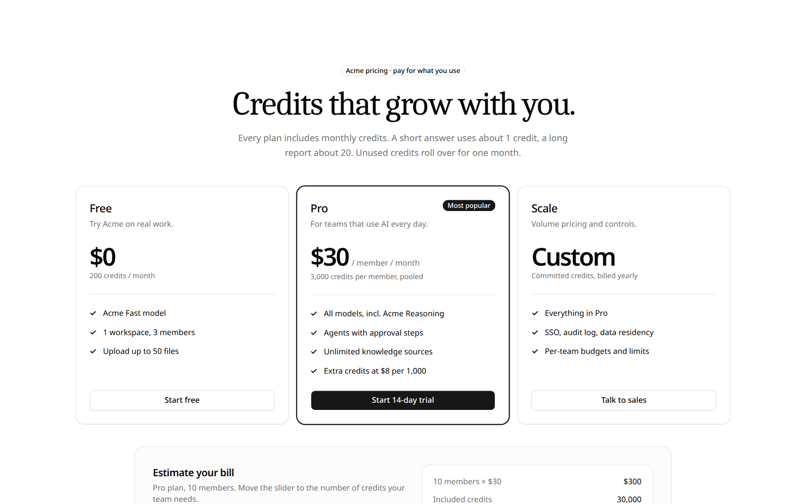

# Usage-Based Pricing — pricing-02

A credit-based pricing section for an AI product: three plans with included credits and overage rates, and a slider that estimates the monthly bill.

<picture><source media="(prefers-color-scheme: dark)" srcset="./preview-dark.png"></picture>

**Basecoat components:** Card, Field, Range, Badge, Button.

**Use:** Copy [`block.html`](./block.html) into a page that loads Tailwind CSS 4 and Basecoat 1.2.1. Basecoat JavaScript is not needed. The slider carries one small inline `oninput` handler that updates the credit count, the estimated total and the filled track. Without it the page still shows the default estimate. Change the rates in that handler together with the plan copy (here: 10 members × $30, 30,000 included credits, $8 per extra 1,000). Plan buttons link to placeholder `/signup` and `/contact/sales` routes. All prices are illustrative; supply real checkout and billing logic in your own application.

**Design rationale:** Credit pricing is hard to picture, so the header turns credits into tasks people know ("a short answer is about 1 credit"). The estimator answers "what will this cost us?" right on the pricing page. Its result is announced politely to screen readers as it changes.
