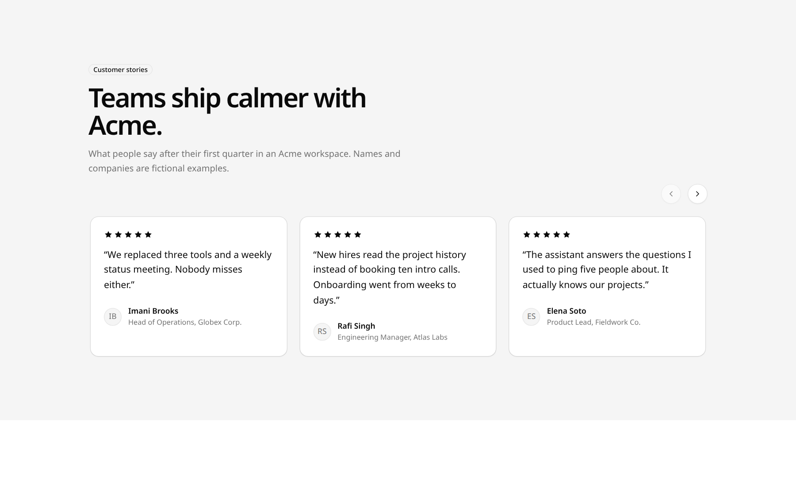

# Testimonials Carousel — testimonials-01

Customer quotes in a scroll-snapping carousel with previous and next buttons.

<picture><source media="(prefers-color-scheme: dark)" srcset="./preview-dark.png"></picture>

**Basecoat components:** Carousel, Card, Avatar, Badge, Button.

**Use:** Copy [`block.html`](./block.html) into a page that loads Tailwind CSS 4 and Basecoat 1.2.1. It needs Basecoat JavaScript: load Basecoat's `all.min.js` once in your page. Swiping, snapping, and keyboard scrolling work without JavaScript. `carousel.js` (in `all.min.js`) reveals the buttons and disables them at the ends. The buttons must stay direct children of `.carousel`, Previous first. Only use real, attributable quotes in production.

**Design rationale:** Showing two and a half cards on mid-width screens hints that there is more to scroll. Ratings use `role="img"` with a text label instead of five unlabeled icons.
