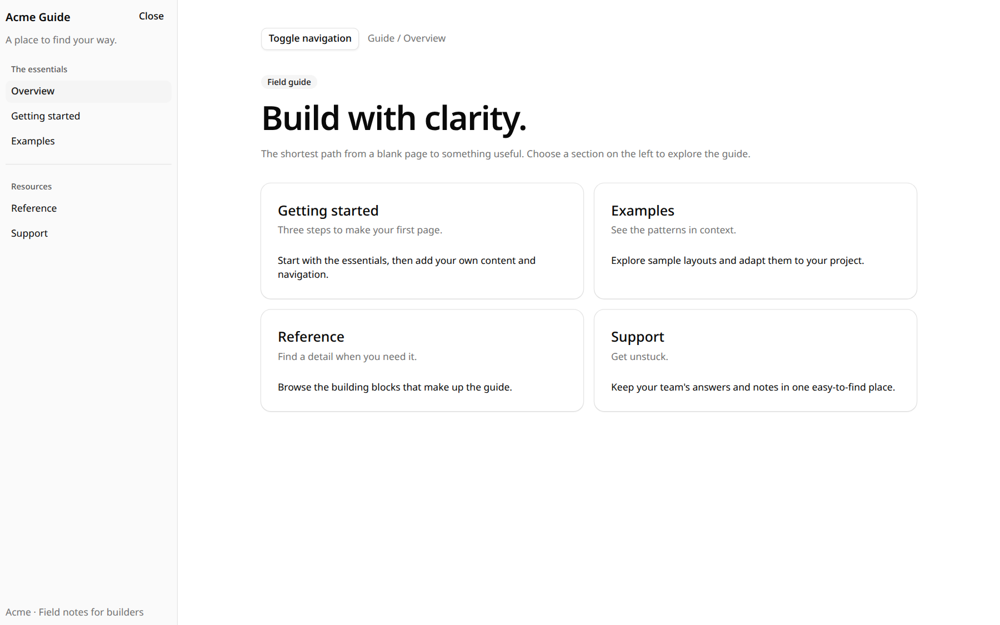

# Basic Sidebar — sidebar-01

A simple responsive guide navigation with named sections and a companion content grid.

<picture><source media="(prefers-color-scheme: dark)" srcset="./preview-dark.png"></picture>

**Basecoat components:** Sidebar, Button, Badge, Card.

**Use:** Copy [`block.html`](./block.html) into a document with Tailwind CSS 4, Basecoat 1.2.1 and Basecoat's `all.min.js`. Keep the `<aside class="sidebar">` immediately before its `<main>` sibling, preserve the unique sidebar ID, and connect navigation anchors and `aria-current="page"` to your actual content and route. No framework or backend is included.

**Design rationale:** Only two named navigation groups make the first viewport easy to understand. The mobile sidebar uses Basecoat's overlay instead of shrinking links to fit a narrow column.
