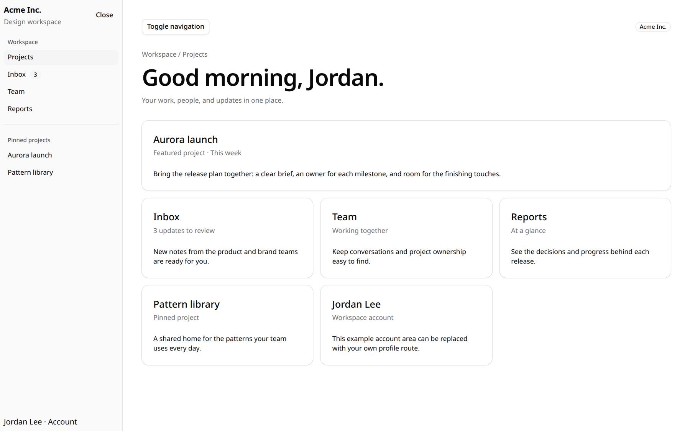

# Workspace Sidebar — sidebar-02

A product workspace navigation with project shortcuts, unread-count context, and a compact account area.

<picture><source media="(prefers-color-scheme: dark)" srcset="./preview-dark.png"></picture>

**Basecoat components:** Sidebar, Button, Badge, Card.

**Use:** Copy [`block.html`](./block.html) into a page loading Tailwind CSS 4, Basecoat 1.2.1 and Basecoat's `all.min.js`. Keep the `<aside>` immediately before its `<main>` sibling and the toggle/close controls bound to the sidebar ID. Replace sample project anchors, account content, badge count, and current-page state with real routes and data. The displayed updates are illustrative; no inbox or account backend is implemented.

**Design rationale:** Grouping core workspace routes separately from pinned work allows frequent navigation without burying the current project. The header and footer keep identity visible while the middle region can scroll.
